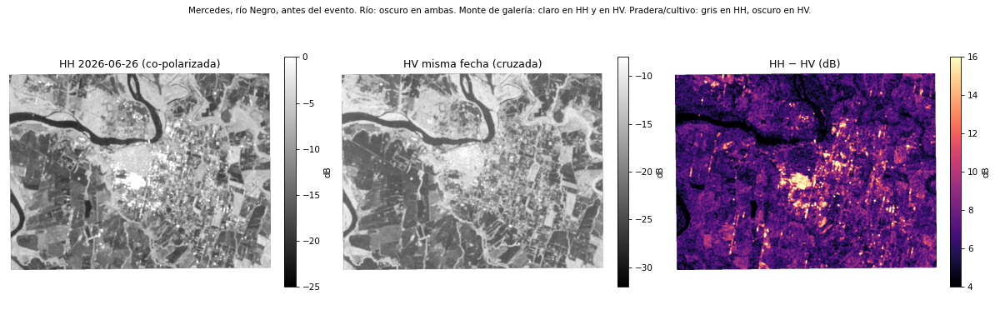
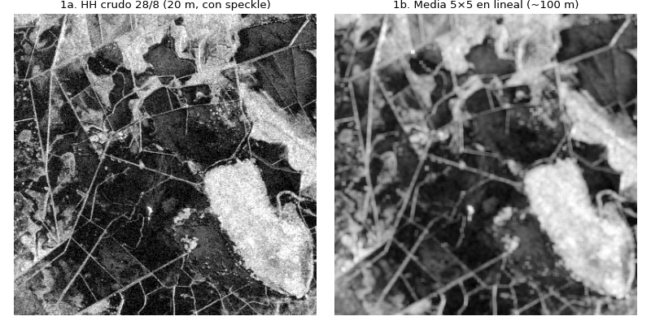
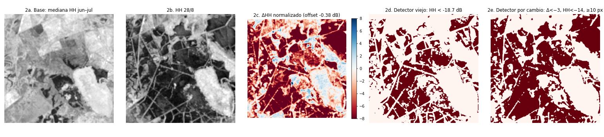
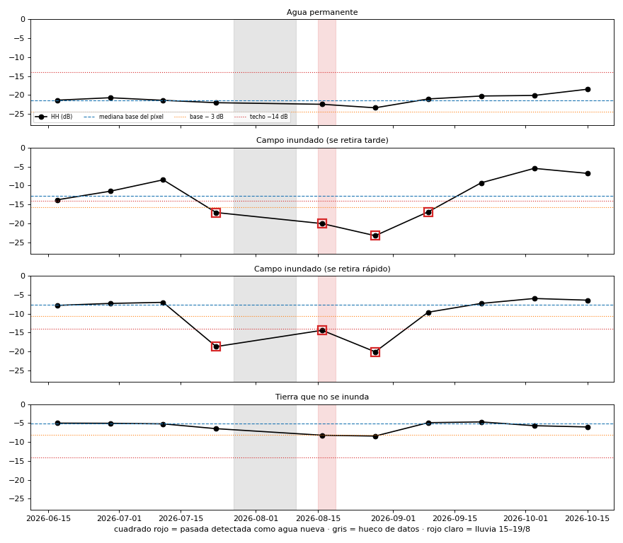
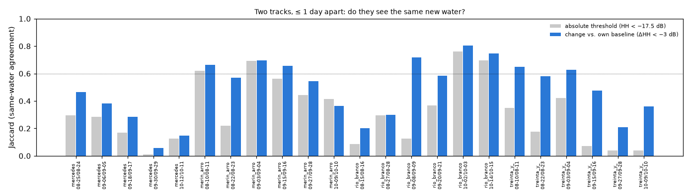
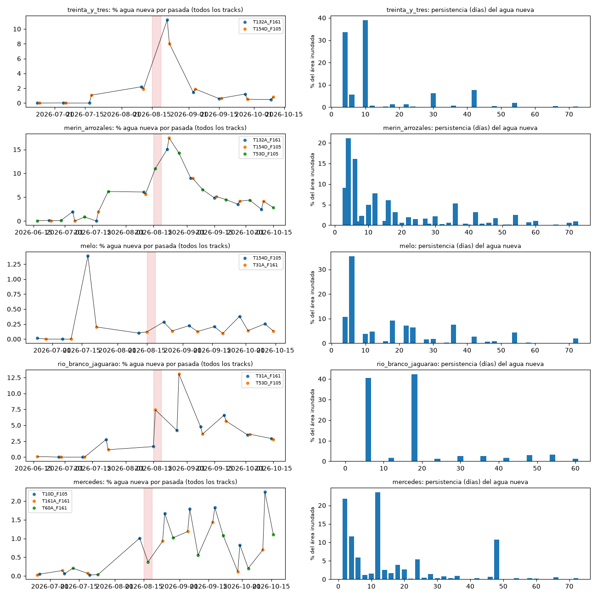
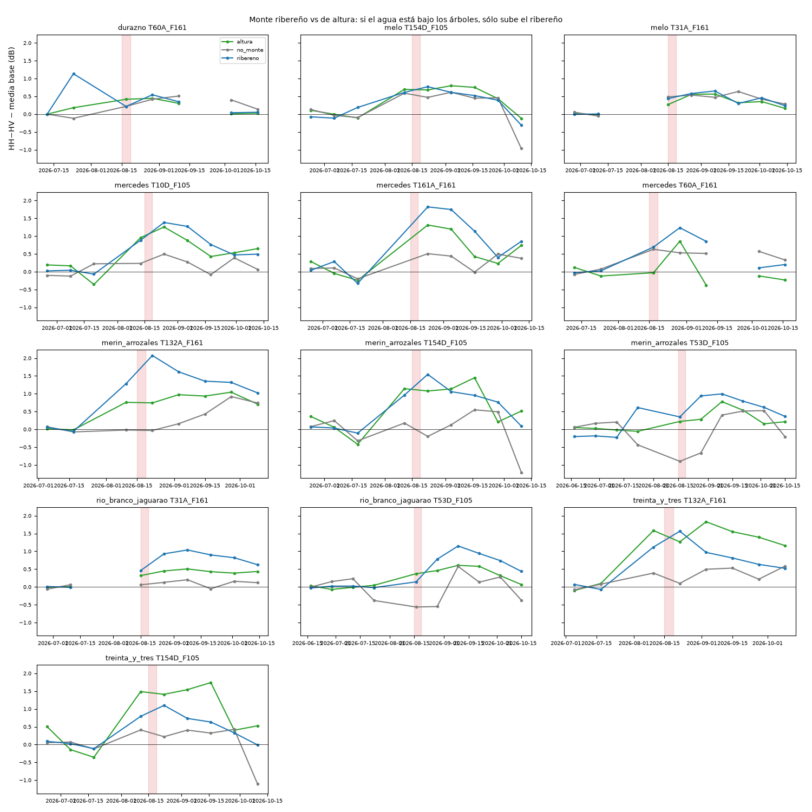
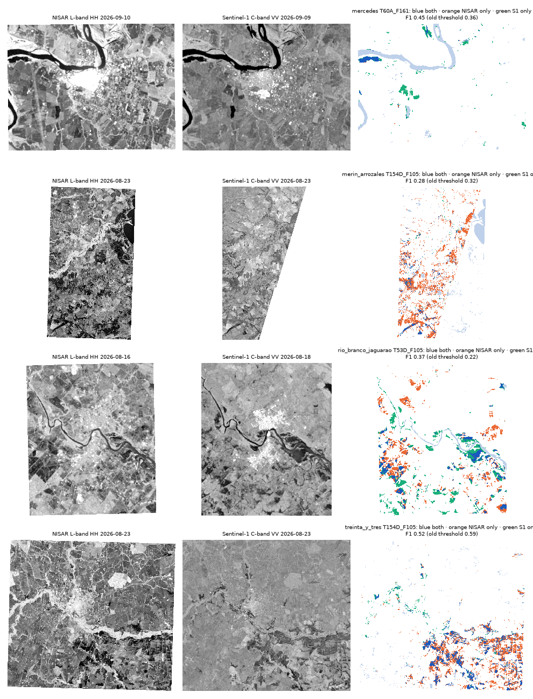

# Guía completa del análisis: del radar en órbita al mapa de la app

**Proyecto:** Dancing with the SARs — NASA Space Apps 2026, equipo Uruguay
**Pregunta:** *How long does the water stay? / ¿Cuánto tiempo se queda el agua?*
**Escrita:** 2026-11-14, a partir del código (`scripts/`), los resultados (`data_nisar/zonas/`), el historial de git y los documentos del repo. Las figuras `figs/guia_*.png` se generaron con los datos reales del proyecto.

---

## Cómo usar esta guía

Está pensada para leerse de corrido la primera vez y después usarse como consulta.

- **Parte I — Fundamentos:** qué es un radar, en qué se diferencia de una cámara satelital, qué son las bandas L y C, qué significan HH y HV, cómo funcionan las órbitas y qué es NISAR. Si nunca trabajaste con radar, empezá acá.
- **Parte II — Herramientas y conceptos de datos:** formatos, proyecciones, GDAL, estadística básica que usa el análisis.
- **Parte III — El análisis paso a paso:** cada script del pipeline, qué entra, qué hace con los datos y qué sale.
- **Parte IV — Problemas que encontramos y cómo se resolvieron:** la historia real del proyecto, con sus errores.
- **Parte V — Resultados, límites y puntos abiertos.**
- **Parte VI — Glosario de siglas y términos**, en orden alfabético.

Cuando aparece una sigla por primera vez se explica en el momento. Si te la olvidás, está en el glosario.

---

# PARTE I — FUNDAMENTOS

## 1. Teledetección: mirar la Tierra desde lejos

**Teledetección** (*remote sensing*) es medir algo sin tocarlo, a partir de la energía que nos llega de ese objeto. Un satélite de observación de la Tierra es, básicamente, un sensor que mide energía electromagnética que viene del suelo.

### 1.1 El espectro electromagnético

La luz visible es una pequeña parte de un rango mucho más amplio de ondas electromagnéticas. Lo que las diferencia es la **longitud de onda** (λ, la distancia entre dos crestas de la onda):

| Región | Longitud de onda | Qué se ve | Ejemplos de satélites |
|---|---|---|---|
| Visible | 0,4–0,7 µm (micrómetros) | Lo que ve el ojo: colores | Sentinel-2, Landsat |
| Infrarrojo cercano (NIR) | 0,7–1,3 µm | Vegetación sana (refleja mucho) | Sentinel-2, Landsat |
| Infrarrojo de onda corta (SWIR) | 1,3–3 µm | Humedad, agua, suelos | Sentinel-2, Landsat |
| Infrarrojo térmico (TIR) | 8–14 µm | Temperatura de la superficie | Landsat, MODIS |
| **Microondas** | **1 mm – 1 m** | **Rugosidad, humedad, estructura** | **NISAR, Sentinel-1, SAOCOM** |

El radar trabaja en **microondas**: ondas miles de veces más largas que la luz visible. Esa diferencia de tamaño es la que explica casi todo lo que sigue.

### 1.2 Sensores pasivos y activos

- **Pasivos:** miden energía que ya existe. Las cámaras ópticas (Sentinel-2, Landsat) miden la luz del sol reflejada; los térmicos miden el calor que emite la superficie. **Necesitan sol** (los ópticos) y **no ven a través de nubes**.
- **Activos:** emiten su propia energía y miden lo que vuelve. El **radar** es activo: manda un pulso de microondas y escucha el eco. **No depende del sol** (funciona de noche) y **las microondas atraviesan las nubes** y la lluvia moderada.

**Por qué esto importa para nuestro proyecto:** durante la crecida del 15–19 de agosto el este de Uruguay estuvo cubierto de nubes. Sentinel-2 (óptico) no pudo ver nada útil; por eso `docs/validacion.md` dice "Sentinel-2: no hecho (nubes durante el evento)". El radar sí vio.

### 1.3 Cámara óptica vs radar, en resumen

| | Óptico (Sentinel-2, Landsat) | Radar (NISAR, Sentinel-1) |
|---|---|---|
| Fuente de energía | Sol | El propio satélite |
| Noche | No | Sí |
| Nubes | Las bloquean | Las atraviesa |
| Qué mide | Color/reflectancia química de la superficie | Rugosidad, geometría, humedad y estructura |
| Cómo se ve el agua | Azul oscura/negra en NIR | Negra (si está calma) |
| Interpretación | Intuitiva, parece una foto | Contraintuitiva, hay que aprender a leerla |
| Ruido típico | Nubes, sombras, bruma | *Speckle* (granulado) |

---

## 2. El radar y el SAR

### 2.1 Cómo funciona un radar de imágenes

**Radar** viene de *RAdio Detection And Ranging*: detectar y medir distancia con ondas de radio.

1. La antena emite un **pulso** corto de microondas.
2. El pulso viaja a la velocidad de la luz, llega al suelo y se dispersa en muchas direcciones.
3. Una pequeña parte vuelve a la antena: el **eco**.
4. El tiempo que tarda el eco dice **a qué distancia** está cada punto. La **intensidad** del eco dice **qué tan "reflectivo" para el radar** es ese punto.

Los radares de imágenes miran **de costado** (*side-looking*), no hacia abajo. Si miraran hacia abajo, dos puntos a la misma distancia a izquierda y derecha devolverían el eco al mismo tiempo y no se podrían distinguir. Mirando de costado, cada distancia corresponde a una sola franja del suelo.

```
           satélite
              ●  ─ ─ ─ dirección de vuelo (hacia adentro de la página)
             /|
            / |
  haz del  /  |  altura (~747 km para NISAR)
  radar   /   |
         /θ   |        θ = ángulo de incidencia
        /     |
 ──────●──────┴──────── suelo
   franja iluminada (swath)
```

El **ángulo de incidencia** (θ) es el ángulo entre el haz del radar y la vertical del suelo. Cambia a lo ancho de la franja: es más chico cerca del satélite (*near range*) y más grande lejos (*far range*). **El mismo campo se ve más o menos brillante según el ángulo con que se lo mire.** Esto va a ser importante cuando comparemos tracks distintos.

### 2.2 Qué es la "apertura sintética" (SAR)

La resolución de un radar depende del tamaño de su antena: para ver detalles de pocos metros desde 700 km de altura con microondas haría falta una antena de kilómetros. Imposible de lanzar.

El truco del **SAR** (*Synthetic Aperture Radar*, radar de apertura sintética): mientras el satélite avanza, un mismo punto del suelo recibe muchos pulsos sucesivos. Combinando matemáticamente todos esos ecos (teniendo en cuenta la fase de cada uno), se "sintetiza" una antena virtual tan larga como el tramo de órbita recorrido. Así se logran resoluciones de metros con una antena física de 12 m (NISAR).

### 2.3 Coherencia y *speckle*

El SAR registra no sólo la intensidad del eco sino su **fase** (en qué punto del ciclo llegó la onda). Eso lo hace un sistema **coherente**. Consecuencia: dentro de cada píxel hay muchos pequeños dispersores (piedras, hojas, terrones) cuyos ecos se suman con fases distintas, a veces reforzándose y a veces anulándose. El resultado es un granulado aleatorio llamado **speckle** (moteado): píxeles vecinos de un mismo campo homogéneo pueden diferir varios dB.

El speckle **no es ruido del instrumento**, es propio de la física de la medición. Se reduce promediando (en el espacio o en el tiempo), a costa de perder resolución. Es la razón del filtro 5×5 del paso 2 (§17).

### 2.4 Distorsiones geométricas (para saber que existen)

Como el radar mide distancias y no ángulos, el relieve produce distorsiones: **acortamiento** (*foreshortening*), **inversión** (*layover*, la cima de un cerro aparece antes que su base) y **sombra de radar** (laderas que el haz no ilumina). Uruguay es casi plano, así que nos afecta poco; además el producto GCOV ya viene corregido por relieve (§4.2).

---

## 3. Qué mide el radar: retrodispersión

### 3.1 Retrodispersión y decibeles

La **retrodispersión** (*backscatter*) es la fracción de la energía enviada que vuelve al satélite desde una superficie. Se expresa con un **coeficiente** adimensional (sin unidades), en escala lineal, que suele ser un número muy chico (0,001 a 1).

Como esos números abarcan varios órdenes de magnitud, se usan **decibeles (dB)**:

```
valor_dB = 10 · log10(valor_lineal)
```

| Lineal | dB | Interpretación |
|---|---|---|
| 1 | 0 dB | Mucha energía vuelve (ciudad, esquina de edificio) |
| 0,1 | −10 dB | Pradera, cultivo |
| 0,01 | −20 dB | Muy poca: agua calma |
| 0,005 | −23 dB | Agua muy calma, casi el piso de ruido |

Reglas útiles:
- **−3 dB ≈ la mitad de la energía.** +3 dB ≈ el doble.
- **−10 dB = 10 veces menos.**
- Un "cambio de −3 dB" (el umbral de nuestro detector) significa que **volvió la mitad o menos** de la energía que volvía normalmente.
- Los promedios se hacen en **lineal**, no en dB. Promediar logaritmos subestima el valor (desigualdad de Jensen). Por eso el código promedia en lineal y después convierte.

### 3.2 Sigma, beta y gamma (σ⁰, β⁰, γ⁰)

El mismo eco se puede normalizar de tres maneras, según a qué área se refiera:
- **β⁰ (beta-cero):** por unidad de área en la geometría del radar (*slant range*). Es lo "crudo".
- **σ⁰ (sigma-cero):** por unidad de área del suelo, asumiendo un elipsoide liso. Es la más usada históricamente.
- **γ⁰ (gamma-cero):** por unidad de área perpendicular al haz. Varía menos con el ángulo de incidencia.

**RTC** (*Radiometric Terrain Correction*, corrección radiométrica por relieve) usa un modelo digital de elevación para corregir el brillo según la pendiente real de cada píxel: una ladera que mira al satélite se ve artificialmente brillante y otra que le da la espalda, artificialmente oscura. El resultado es **γ⁰ RTC**, que es lo que trae el producto GCOV de NISAR y el Sentinel-1 RTC que usamos para validar. Es la mejor magnitud para comparar fechas y sensores.

### 3.3 De qué depende el brillo de un píxel

Tres familias de factores:

1. **Rugosidad de la superficie, comparada con la longitud de onda.** Una superficie es "lisa" para el radar si sus irregularidades son mucho menores que λ. El agua calma es lisa para cualquier banda; un campo arado puede ser rugoso en banda C (λ ≈ 5,6 cm) y relativamente liso en banda L (λ ≈ 24 cm).
2. **Constante dieléctrica (humedad).** Mide cuánto interactúa un material con el campo eléctrico. El agua tiene una constante dieléctrica muy alta (~80) frente al suelo seco (~3–5). **Suelo mojado = más brillante** (si es rugoso); **agua libre = espejo** (oscura si está calma).
3. **Geometría y estructura:** ángulo de incidencia, orientación de surcos y filas, presencia de tallos, troncos, paredes.

---

## 4. Mecanismos de dispersión: cómo "se ve" cada cosa

Este es el concepto más importante para entender el proyecto.

### 4.1 Los cuatro mecanismos

```
1. ESPECULAR (agua calma)          2. SUPERFICIE RUGOSA (pradera, suelo)
   radar                               radar
     \                                   \
      \   (casi nada vuelve)              \   ↖ ↑ ↗  (algo vuelve)
       \ ↘                                 \ ↖↑↗
 ~~~~~~~~~~~~~~~  →  OSCURO          ‿‿⌒‿⌒‿‿⌒‿‿   →  GRIS

3. VOLUMEN (copas, biomasa)        4. DOBLE REBOTE (agua + tronco, o calle + pared)
   radar                               radar
     \   ↗↖↑↗↖                             \        ↗ (vuelve casi todo)
      \ ♣♣♣♣♣                               \      |
       \♣♣♣♣♣  rebota muchas veces          \     |  tronco / pared
        ♣♣♣♣♣                                 ↘__|
 ─────────────  →  CLARO, y mucho en HV   ~~~~~~~~~~  →  MUY CLARO en HH
```

| Mecanismo | Dónde ocurre | Cómo se ve | Polarización más sensible |
|---|---|---|---|
| **Especular** | Agua calma, asfalto liso | Muy oscuro (−20 a −25 dB) | Ambas oscuras |
| **Superficie rugosa** | Pradera, suelo arado, agua con olas | Gris (−8 a −15 dB) | HH/VV más que HV |
| **Volumen** | Copas de árboles, cultivos densos | Claro (−5 a −10 dB), **HV alto** | HV (la despolarización la genera el rebote múltiple) |
| **Doble rebote** | Agua bajo árboles, arroz inundado, ciudades | Muy claro (> −5 dB, hasta > 0) | **HH** (sube mucho más que HV) |

### 4.2 Consecuencias directas para el proyecto

- **Agua abierta = oscura.** Por eso el detector busca píxeles que se oscurecieron.
- **Agua con viento = menos oscura.** Las olitas rompen el espejo y devuelven algo de señal. Un mismo lago puede verse a −22 dB un día calmo y a −14 dB un día ventoso.
- **Agua bajo árboles = más clara, no más oscura.** El agua reemplaza al suelo bajo el monte y forma un espejo; la señal rebota agua → tronco → satélite. Por eso el "agua bajo el monte" (§22) se busca como una **subida** de HH y de HH−HV.
- **Ciudades = muy claras siempre** (calle + pared = doble rebote). Si una calle se inunda, el doble rebote puede incluso **aumentar**. Por eso el radar "no ve" el agua dentro de las ciudades y medimos en un anillo alrededor (§24).
- **Agua somera con pasto o arroz asomando:** mezcla de especular y doble rebote. Se oscurece respecto de lo normal, pero no tanto como el agua abierta. Fue la clave del problema del detector (§29).

---

## 5. Bandas de frecuencia: X, C, S, L, P

Los radares se agrupan por **banda**, una letra heredada de la Segunda Guerra Mundial que identifica un rango de frecuencias. Frecuencia y longitud de onda son inversas: λ = c / f (c = velocidad de la luz).

| Banda | Frecuencia aprox. | λ aprox. | Penetración en vegetación | Misiones |
|---|---|---|---|---|
| X | 8–12 GHz | ~3 cm | Muy poca: rebota en las hojas | TerraSAR-X, COSMO-SkyMed, ICEYE |
| **C** | 4–8 GHz | **~5,6 cm** | Poca: se satura en el follaje | **Sentinel-1**, RADARSAT-2, RCM |
| S | 2–4 GHz | ~9–10 cm | Intermedia | NISAR (S, para India), NovaSAR |
| **L** | 1–2 GHz | **~24 cm** | **Buena: atraviesa copas y pasto** | **NISAR**, SAOCOM, ALOS-2 |
| P | 0,3–1 GHz | ~70 cm | Muy alta: llega a troncos y suelo | Biomass (ESA) |

**La regla práctica:** una onda interactúa sobre todo con objetos de tamaño parecido a su longitud de onda. Una onda de 5,6 cm (C) "choca" con hojas y ramitas; una de 24 cm (L) pasa entre ellas y llega a troncos, tallos gruesos y al suelo o al agua de abajo.

**Qué significa para nosotros:**
- **NISAR (banda L)** puede ver agua debajo del pasto alto, del arroz emergente y del monte de galería.
- **Sentinel-1 (banda C)** se **satura** antes: si hay vegetación asomando sobre el agua, la señal rebota en ella y el agua no se nota. Por eso en la validación (§26) NISAR marca **más** agua que Sentinel-1, y buena parte de esa diferencia es agua somera con vegetación que la banda C no llega a ver.
- La banda L también es menos sensible a la rugosidad fina (pequeñas olas, surcos), lo que la hace algo más estable.

---

## 6. Polarización: HH, HV, VV, VH

### 6.1 Qué es la polarización

Una onda electromagnética oscila en un plano. Si oscila horizontalmente es **H**; si oscila verticalmente es **V**. El radar elige cómo **emite** y cómo **recibe**, y cada combinación se nombra con dos letras: **la primera es la de emisión y la segunda la de recepción**.

| Canal | Emite | Recibe | Tipo |
|---|---|---|---|
| **HH** | Horizontal | Horizontal | Co-polarizada (*co-pol*) |
| **HV** | Horizontal | Vertical | Polarización cruzada (*cross-pol*) |
| VV | Vertical | Vertical | Co-polarizada |
| VH | Vertical | Horizontal | Polarización cruzada |

- **Co-polarizada (HH, VV):** la onda vuelve con la misma orientación con que salió. Domina en superficies (especular, rugosa) y en el doble rebote.
- **Cruzada (HV, VH):** la onda vuelve "girada". Eso sólo pasa cuando rebota muchas veces en estructuras desordenadas: copas, cultivos densos. **HV es un indicador de biomasa/vegetación.** En agua y suelo desnudo, HV es muy bajo.

Configuraciones de un sensor:
- **Single-pol:** un solo canal (ej. sólo HH).
- **Dual-pol:** dos canales (ej. HH+HV en NISAR sobre Uruguay; VV+VH en Sentinel-1 sobre tierra).
- **Quad-pol** (*full-pol*): los cuatro canales.

### 6.2 Cómo lo nombra NISAR

En el nombre de cada escena aparecen códigos como `DHDH` o `SHSH`: **D** = *dual* (dual-pol), **S** = *single*, **H** = emisión horizontal. `DHDH` quiere decir que las dos sub-bandas de frecuencia (A y B) son dual-pol con emisión H → tenemos **HH y HV**. `SHSH` = single-pol → **sólo HH**. Por eso 6 recortes de HV fallaron en la descarga (§28.5).

El producto GCOV guarda la **matriz de covarianza** de las polarizaciones. Los términos de la diagonal (`HHHH`, `HVHV`) son la **potencia** de cada canal: es lo que bajamos.

### 6.3 Qué nos dice cada canal y la diferencia HH−HV

| Superficie | HH | HV | HH−HV |
|---|---|---|---|
| Agua abierta calma | Muy bajo (~−22 dB) | Muy bajo (~−30 dB) | Variable |
| Pradera / cultivo bajo | Medio (~−10) | Bajo (~−20) | ~10 dB |
| Monte | Alto (~−5) | Alto (~−12) | ~7 dB (bajo: domina el volumen) |
| Monte **inundado** | **Sube** (doble rebote) | Sube poco | **Sube** |
| Ciudad | Muy alto (> 0) | Alto | Muy alto |

**HH−HV en dB es el cociente HH/HV en lineal.** Es útil porque cancela parte de los efectos que afectan a ambos canales por igual (calibración, humedad general) y resalta el **doble rebote**, que aumenta HH mucho más que HV. Es la métrica que usa `monte_ribereno.py`.


*Mercedes (track 10D), 26/6, antes del evento. El río Negro es negro en HH y en HV. La ciudad es blanca en HH y tiene el HH−HV más alto (doble rebote de calles y paredes). Los campos son grises en HH y oscuros en HV. El monte de galería junto al río es claro en ambos canales.*

---

## 7. Órbitas, tracks y frames

### 7.1 Órbita heliosincrónica "amanecer-atardecer"

NISAR, como Sentinel-1, está en una **órbita polar heliosincrónica**: pasa de polo a polo y cruza cada latitud siempre a la **misma hora solar local**. En particular es una órbita **amanecer-atardecer** (*dawn-dusk*): vuela siempre sobre la línea que separa el día de la noche. Para un radar es ideal: los paneles solares reciben sol todo el tiempo y no importa que abajo sea de noche.

### 7.2 Ascendente y descendente

Cada vuelta tiene dos mitades:
- **Ascendente (A):** el satélite va de sur a norte.
- **Descendente (D):** va de norte a sur.

Sobre Uruguay, según la hora en los nombres de los archivos (UTC, *Tiempo Universal Coordinado*; Uruguay = UTC−3):

| Tipo | Hora UTC | Hora local | Tracks |
|---|---|---|---|
| **Ascendente** | 09:29–09:54 | **~06:30–07:00 (amanecer)** | 31A, 60A, 132A, 161A |
| **Descendente** | 21:34–21:59 | **~18:30–19:00 (atardecer)** | 10D, 53D, 154D |

Además miran desde lados opuestos: al cambiar la dirección de vuelo cambia la dirección desde la cual el radar ilumina el terreno.

> **Corrección importante:** varios documentos del repo (`docs/validacion.md`, el docstring de `armonizar_tracks.py` y un texto de `app/index.html`) dicen lo contrario: que los descendentes pasan ~6 h y los ascendentes ~18 h. Los nombres de las escenas muestran que es al revés. Ver §30.

### 7.3 Track, frame, revisita, *swath*

- **Track** (o *path*, órbita relativa): cada una de las trayectorias que el satélite repite exactamente. NISAR repite su ciclo cada **12 días**, así que el track 53 pasa por el mismo lugar cada 12 días, con la misma geometría. En el proyecto, `53D` = track 53 descendente.
- **Frame:** un tramo fijo a lo largo del track (como cortar una tira larga en rectángulos). `T53D_F105` = track 53 descendente, frame 105.
- **Revisita:** cada cuánto se observa un lugar. Para **un** track son 12 días. Como las franjas de tracks vecinos se superponen, un lugar puede quedar cubierto por varios tracks, y **combinándolos** la revisita efectiva baja (en Merín, con 3 tracks, hay observaciones cada 1 a 6 días).
- **Swath** (franja): el ancho de suelo cubierto en una pasada. NISAR cubre más de 240 km.

### 7.4 Por qué no se pueden mezclar tracks directamente

Cada track ve el mismo lugar con **otro ángulo de incidencia, desde otro lado, a otra hora** y con una calibración levemente distinta. Un campo puede dar −12 dB en un track y −15 dB en otro el mismo día. Si se comparan dB de tracks distintos, se confunden diferencias de geometría con cambios reales. De ahí la **regla 2 del equipo**: cada serie temporal usa un solo track, y los tracks se combinan sólo después de convertir cada uno en una máscara de agua (§21).

---

## 8. NISAR

### 8.1 La misión

**NISAR** = *NASA-ISRO Synthetic Aperture Radar*. Es una misión conjunta de la **NASA** (agencia espacial de EE. UU.) y la **ISRO** (*Indian Space Research Organisation*, agencia espacial de la India).

| Dato | Valor |
|---|---|
| Lanzamiento | 30 de julio de 2025, desde India |
| Radares | **Banda L** (NASA/JPL) y **banda S** (ISRO) |
| Antena | Reflector de 12 m desplegado con un brazo de ~9 m |
| Órbita | Heliosincrónica amanecer-atardecer, ~747 km de altura |
| Repetición | 12 días |
| Franja | > 240 km (técnica *SweepSAR*) |
| Datos L | Libres y abiertos, vía ASF |

**JPL** (*Jet Propulsion Laboratory*) es el centro de la NASA que construyó el radar L y procesa los productos. **ASF** (*Alaska Satellite Facility*) es el **DAAC** (*Distributed Active Archive Center*, centro de archivo de datos de la NASA) que los distribuye. Los datos viven en **Earthdata Cloud**, la nube de NASA montada sobre **AWS** (*Amazon Web Services*).

### 8.2 Niveles de producto

Los productos se ordenan por **nivel** de procesamiento:

| Nivel | Producto | Qué es |
|---|---|---|
| L0B | RRSD | Datos crudos de radar |
| L1 | RSLC | Imagen compleja (amplitud + fase) en geometría de radar |
| L1 | RIFG, RUNW, ROFF | Interferogramas y desplazamientos en geometría de radar |
| L2 | GSLC | Imagen compleja geocodificada |
| **L2** | **GCOV** | **Covarianza polarimétrica geocodificada: γ⁰ RTC en grilla de mapa (20 m). La usamos nosotros.** |
| L2 | GUNW | Interferograma desenrollado geocodificado (deformación del suelo, cm) |
| L2 | GOFF | Desplazamientos de píxeles geocodificados (glaciares, sismos grandes) |
| L3 | SME2 | Humedad del suelo |

GCOV es el más fácil para mapear agua: ya está en coordenadas de mapa, corregido por relieve y en potencia. No requiere interferometría (InSAR, la técnica que usa la fase para medir deformaciones de centímetros).

### 8.3 Madurez de los datos y versiones de software

NISAR publica sus datos en etapas de **madurez**:

| Madurez | Publicación | Calidad | Cobertura temporal |
|---|---|---|---|
| BETA | Feb 2026 | Sin calibrar del todo | Subconjunto oct 2025–ene 2026 (**nada sobre Uruguay**) |
| PROVISIONAL | 20 jul 2026 | Calibrado, validado parcialmente | Desde 17/6/2026 hasta ~23/10/2026 |
| VALIDATED | 6 nov 2026 | Calibrado y validado | Desde 21/10/2026 en adelante |

El **CRID** (*Composite Release ID*) identifica la versión del software de procesamiento: PROVISIONAL usa P05023 y VALIDATED P05036. **Cambiar de versión cambia la calibración**: es el origen del salto de −1,7 dB que encontramos (§28.3). Regla 3 del equipo: no mezclar PROVISIONAL y VALIDATED sin normalizar.

Hay un **hueco global de datos** entre el 27/7 y el 10/8 de 2026: el instrumento no adquirió. No hay ninguna imagen de esas dos semanas en ningún lugar del mundo.

### 8.4 Comparación de los sensores del proyecto

| | **NISAR** | **Sentinel-1** | Sentinel-2 | SAOCOM |
|---|---|---|---|---|
| Agencia | NASA + ISRO | ESA (Unión Europea, programa Copernicus) | ESA | CONAE (Argentina) |
| Tipo | Radar SAR | Radar SAR | Óptico | Radar SAR |
| Banda / λ | **L, 24 cm** (+ S) | **C, 5,6 cm** | Visible e infrarrojo | L, 24 cm |
| Polarización sobre Uruguay | HH + HV | VV + VH | — | Variable |
| Resolución usada | 20 m | 10 m (llevado a 20 m) | 10 m | 10–50 m |
| Revisita por órbita | 12 días | 12 días por satélite | 5 días (con nubes) | 16 días por satélite |
| Rol en el proyecto | **Análisis principal** | **Validación independiente** | No usado (nubes) | Considerado, no usado |

**ESA** = *European Space Agency*. **CONAE** = Comisión Nacional de Actividades Espaciales de Argentina.

---

# PARTE II — HERRAMIENTAS Y CONCEPTOS DE DATOS

## 9. Datos raster y geoespaciales

- **Raster:** imagen formada por una grilla de **píxeles**, cada uno con un valor (brillo en dB, 0/1 de agua, días, etc.). Nuestros rasters tienen píxeles de **20 × 20 m = 400 m² = 0,04 ha**.
- **Grilla:** la definición exacta de dónde está cada píxel: origen, tamaño de píxel, número de filas y columnas. Se guarda en la **transformada afín** (*transform*). Dos rasters con la misma grilla se pueden comparar píxel a píxel.
- **CRS** (*Coordinate Reference System*, sistema de referencia de coordenadas): cómo se traducen las coordenadas a lugares de la Tierra.
  - **WGS84** (EPSG:4326): latitud/longitud en grados. Lo usamos para definir las zonas y para la app.
  - **UTM** (*Universal Transverse Mercator*): divide el mundo en husos de 6° y usa metros. Uruguay cae en los husos **21S** (EPSG:32721, oeste) y **22S** (EPSG:32722, este). Los recortes NISAR quedan en el huso nativo de cada frame.
  - **EPSG:** código numérico estándar de cada CRS.
- **WKT** (*Well-Known Text*): forma de escribir geometrías como texto. Las zonas en `zonas.py` son `POLYGON((lon lat, lon lat, ...))`.
- **AOI** (*Area Of Interest*): el área de interés; en el proyecto, cada uno de los 6 rectángulos.
- **Remuestreo** (*resampling*): calcular valores para una grilla nueva a partir de otra.
  - **Vecino más cercano** (*nearest*): toma el valor del píxel más cercano. Para **categorías** (0/1, clases). Lo usa `combinar_tracks.py`.
  - **Bilineal:** interpola entre los 4 vecinos. Para **valores continuos** (elevación). Lo usa el DEM.
  - **Moda:** el valor más frecuente. Para **clasificaciones** a menor resolución. Lo usa WorldCover.
  - **Promedio:** para valores continuos al pasar a resolución más gruesa. Lo usa Sentinel-1 (10 → 20 m).
- **Vector:** geometrías (puntos, líneas, polígonos) con atributos: caminos, ríos, localidades. **Rasterizar** = convertir vector a raster.

## 10. Formatos de archivo

| Formato | Qué es | Dónde aparece |
|---|---|---|
| **HDF5** (*Hierarchical Data Format 5*) | Contenedor con estructura de carpetas internas | Escenas NISAR: `/science/LSAR/GCOV/grids/frequencyA/HHHH` |
| **GeoTIFF** | Imagen TIFF con información geográfica | Todos nuestros rasters |
| **COG** (*Cloud-Optimized GeoTIFF*) | GeoTIFF organizado en bloques para leer sólo una parte por HTTP | Recortes descargados; Sentinel-1 y WorldCover en la nube |
| **GeoPackage (.gpkg)** | Base de datos geográfica en un archivo | Capas de contexto por zona |
| **GeoJSON** | Vector en JSON, legible por navegadores | Caminos, localidades y subcuencas de la app |
| **.osm.pbf** | Formato binario comprimido de OpenStreetMap | Extracto de Uruguay de Geofabrik |
| **CSV** | Tabla en texto | Resúmenes y resultados |
| **WebP / PNG** | Imágenes con transparencia | Capas de la app |

## 11. Herramientas de software

- **GDAL** (*Geospatial Data Abstraction Library*): la librería base del mundo geoespacial. Lee y escribe casi cualquier formato. Usamos sus comandos `gdalinfo` (ver qué tiene un archivo) y `gdalwarp` (recortar, reproyectar, remuestrear).
- **`/vsicurl/`**: "sistema de archivos virtual" de GDAL que lee archivos remotos por HTTP pidiendo sólo los bytes necesarios. Gracias a esto se recorta una escena de 2 GB bajando unos pocos MB.
- **`/vsis3/`**: lo mismo para *buckets* S3 de AWS (DEM Copernicus, WorldCover).
- **Python** con: `numpy` (matrices), `pandas` (tablas y fechas), `rasterio` (leer/escribir rasters), `scipy.ndimage` (filtros, componentes conectados, transformada de distancia), `geopandas` y `shapely` (vectores), `matplotlib` (gráficos), `pillow` (imágenes), `asf_search` (buscar escenas en ASF), `scikit-image` (Otsu).
- **`~/.netrc`**: archivo en tu carpeta personal con usuario y contraseña de **Earthdata Login** (EDL, el sistema de cuentas de datos de NASA). GDAL lo lee para autenticarse.
- **STAC** (*SpatioTemporal Asset Catalog*): estándar para catálogos de imágenes. Lo usa Microsoft **Planetary Computer**, de donde bajamos Sentinel-1. Pide un **token SAS** (*Shared Access Signature*) anónimo para leer los archivos.
- **MapLibre GL:** librería de mapas web interactivos usada en la app.

## 12. Estadística y procesamiento de imágenes usados

- **Mediana:** el valor del medio al ordenar. A diferencia del promedio, **no se deja arrastrar por valores extremos**. Si de 4 fechas de base una tiene agua por una lluvia, la mediana casi no se mueve. Por eso la base es una mediana.
- **Umbral:** valor de corte para clasificar (ej. "agua si HH < −18 dB").
- **Histograma bimodal:** distribución con dos "jorobas" (ej. agua y tierra). Cuando existe, el umbral natural está en el valle entre ambas.
- **Método de Otsu:** algoritmo que elige automáticamente el umbral que mejor separa dos grupos en un histograma. Funciona bien sólo si el histograma es bimodal (§28.2).
- **Media móvil 5×5:** reemplaza cada píxel por el promedio de un cuadrado de 5×5 a su alrededor. Reduce el speckle.
- **Componentes conectados:** grupos de píxeles vecinos que cumplen una condición ("manchas"). Con `scipy.ndimage.label` se numeran y se mide su tamaño.
- **MMU** (*Minimum Mapping Unit*, unidad mínima de mapeo): tamaño mínimo para que una mancha cuente. Nuestra MMU es 10 píxeles = 0,4 ha.
- **Transformada de distancia:** para cada píxel, la distancia al píxel "objetivo" más cercano (ej. al cauce) y cuál es ese píxel.
- **Índice de Jaccard** (IoU, *Intersection over Union*): compara dos máscaras. `|A ∩ B| / |A ∪ B|`. 1 = idénticas, 0 = sin superposición.
- **Matriz de confusión y métricas,** tomando una referencia como "verdad":
  - **Verdadero positivo (VP):** ambos dicen agua. **Falso positivo (FP):** el nuestro dice agua y la referencia no. **Falso negativo (FN):** la referencia dice agua y el nuestro no.
  - **Precisión** = VP / (VP + FP): de lo que marcamos, cuánto es correcto.
  - **Exhaustividad** (*recall*) = VP / (VP + FN): de lo que había, cuánto encontramos.
  - **F1** = media armónica de precisión y exhaustividad: 2·P·R / (P + R). Resume ambas en un número.
- **Análisis de sensibilidad:** repetir el cálculo con parámetros razonablemente distintos para ver cuánto cambia el resultado.

---

# PARTE III — EL ANÁLISIS PASO A PASO

## 13. Visión general del pipeline

```
 NISAR GCOV (HDF5, 1–2 GB por escena, en Earthdata Cloud)
   │ 1  descargar_zonas.py     recorte por zona y track → GeoTIFF HH/HV (γ⁰ lineal, 20 m)
   ▼
 Pila de imágenes por track (misma grilla, 8–10 fechas, 15/6 → 20/10)
   │ 2  metricas_evento.py     grilla común → speckle → base → agua permanente → agua NUEVA por fecha
   │                           → extensión, primera fecha, retiro, persistencia (intervalo)
   │ 3  armonizar_tracks.py    ¿dos tracks a ≤ 1 día ven lo mismo? → justifica el detector
   │ 4  combinar_tracks.py     junta las máscaras de todos los tracks → revisita 1–6 días,
   │                           extensión confirmada (≥ 2 observaciones)
   │ 5  sensibilidad.py        banda de incertidumbre por parámetros
   ▼
 Rasters de métricas por zona
   │ 6  capas_contexto.py      OSM, HydroBASINS, WorldCover (sólo contexto)
   │ 7  monte_ribereno.py      DEM → HAND → monte ribereño vs de altura → agua bajo el monte
   │ 8  agregar_impacto.py     caminos, localidades, subcuencas, departamentos, cobertura, ha·día
   │ 9  validar_s1.py          Sentinel-1 como prueba independiente (no entra en el análisis)
   ▼
   10 exportar_app.py → app/data/ (manifest.json + imágenes + GeoJSON) → app/index.html
```

**Las 4 reglas del equipo** atraviesan todo el pipeline:
1. El análisis se basa sólo en NISAR. Todo lo demás (Sentinel-1, OSM, DEM, WorldCover, prensa) es **contexto o validación**, nunca entra en las series ni en los umbrales.
2. **Un track por serie temporal.** Los tracks se combinan sólo como máscaras.
3. **No mezclar PROVISIONAL y VALIDATED** sin normalizar.
4. Las cifras de prensa son preliminares.

## 14. Las zonas de estudio

Definidas en `scripts/zonas.py`. Cada una tiene un rectángulo (WKT), los tracks que la cubren, el track de la **serie principal** (`serie`, el que se usa cuando hace falta una sola serie, regla 2) y, opcionalmente, un `fin_base` propio.

| Zona | Qué representa | Tracks | Serie principal |
|---|---|---|---|
| `treinta_y_tres` | Ciudad y bajo río Olimar (~1.600 desplazados) | 132A, 154D | 154D |
| `merin_arrozales` | Llanura arrocera del Cebollatí–Tacuarí, borde de la Laguna Merín | 53D, 132A, 154D | 53D |
| `melo` | Arroyo Conventos | 31A, 154D | 31A |
| `rio_branco_jaguarao` | Río Yaguarón, frontera con Brasil | 53D, 31A | 53D |
| `durazno` | Río Yí (crecida de julio y pico del 22/8) | 60A | 60A |
| `mercedes` | Río Negro aguas abajo, monte de galería | 10D, 161A, 60A | 10D |

Las 4 primeras están en la **cuenca de la Laguna Merín** (vertiente atlántica). Durazno y Mercedes están en la **cuenca del río Negro** (vertiente del río Uruguay). La idea es comparar cómo respondió cada cuenca a la misma lluvia.

**Ventana temporal:** 15/6 → 20/10/2026, sólo PROVISIONAL.
- **Línea de base:** antes del 27/7 (inicio del hueco de datos). Son 3–4 fechas por track. Durazno: antes del 20/7.
- **Ventana del evento:** 10/8 → 10/9 (la primera pasada después del hueco hasta unas 3 semanas después de la lluvia).
- **Post-evento:** 10/9 → 20/10, para ver el retiro.

## 15. Paso 1 — Descarga (`descargar_zonas.py`)

**Entrada:** `zonas.py`. **Salida:** `data_nisar/zonas/{zona}/T{track}{dir}_F{frame}/{fecha}_{HH|HV}.tif`.

1. **Búsqueda.** `asf_search.search(dataset="NISAR", processingLevel="GCOV", dataMaturity="PROVISIONAL", intersectsWith=<WKT>, start, end)` devuelve las escenas que tocan la zona. Se filtra por (track, dirección, frame).
2. **Duplicados.** Puede haber más de una escena por fecha (reprocesamientos, otros modos de adquisición). Se prefiere el **modo principal**, el que en el nombre tiene `2005_..._M_..._N_F_`. Según la convención de nombres de NISAR, `2005` indica el ancho de banda de las dos sub-bandas (20 y 5 MHz) y `F` un frame completo (`P` = parcial).
3. **Recorte remoto.** Para cada escena y polarización:
   ```
   gdalwarp -of COG -cutline "<WKT de la zona>" -cutline_srs WGS84 -crop_to_cutline \
     'HDF5:"/vsicurl/https://nisar.asf.earthdatacloud.nasa.gov/.../escena.h5"://science/LSAR/GCOV/grids/frequencyA/HHHH' \
     2026-08-28_HH.tif
   ```
   - `HDF5:"..."://ruta` le dice a GDAL: "abrí este HDF5 remoto y leé este dataset interno".
   - `/vsicurl/` + las cookies de Earthdata (vía `~/.netrc`) permiten leer sólo los bloques que caen dentro del recorte.
   - `-cutline` + `-crop_to_cutline` recortan al rectángulo. La proyección queda la **nativa** del frame (UTM), sin remuestrear, para no degradar los datos.
   - `frequencyA` es la sub-banda principal de la banda L.
4. **Robustez:** escribe a `.part.tif` y renombra al terminar; se paraleliza con varios *workers*; si un archivo ya existe se saltea. Se puede volver a correr cuantas veces haga falta.

**Resultado:** 232 recortes esperados, 226 bajados (los 6 restantes son HV de escenas SHSH, que no tienen HV). Unos 3 GB.

## 16. Paso 2a — Cargar un track con una grilla común (`metricas_evento.py → cargar_track`)

Para comparar fechas píxel a píxel, todas tienen que tener **exactamente la misma grilla**. Normalmente es así dentro de un track, pero alguna escena puede venir con otro tamaño u origen (otro frame, otro modo).

1. Lee la forma y la transformada de cada `*_HH.tif`.
2. Elige la grilla **modal** (la más repetida).
3. Descarta las fechas con otra grilla e imprime cuáles fueron.
4. Lee HH y HV, convierte valores ≤ 0 o no finitos a **NaN** (*Not a Number*, "sin dato").
5. Si falta el HV (escena SHSH), lo rellena con NaN para que la pila quede completa.

## 17. Paso 2b — Reducir el speckle

```python
hh_db = 10 * log10( media_5x5_ignorando_NaN( hh_lineal ) )
```

- La media se hace en **lineal** (energía), por la razón de §3.1.
- "Ignorando NaN": suma los valores válidos y divide por la cantidad de válidos, para no comerse los bordes del recorte.
- 5×5 píxeles de 20 m = ventana de 100 m. La imagen pierde detalle fino pero los campos homogéneos quedan limpios.


*Arrozales de la Merín, 28/8. Izquierda: HH crudo con speckle. Derecha: después de la media 5×5. Los lotes inundados (negros) quedan como bloques definidos.*

## 18. Paso 2c — Línea de base y agua permanente

**Objetivo:** saber qué es "normal" en cada píxel antes de la crecida, y separar el agua que siempre está (lagunas, ríos, tajamares) del agua nueva.

1. **Fechas de base:** las anteriores al 27/7 (Durazno: 20/7).
2. **Umbral de agua permanente por track** (`calibrar_umbral`):
   - "Agua segura": píxeles con HH < −20 dB en **todas** las fechas base. "Tierra segura": HH > −14 dB en todas.
   - Si hay al menos 200 píxeles de cada una: `umbral = agua + 0,3 × (tierra − agua)`, recortado a [−20, −17,5] dB.
   - Ejemplo 53D: agua −22,8 dB, tierra −9,2 dB → −22,8 + 0,3 × 13,6 = **−18,7 dB**.
   - Si no hay suficientes píxeles (zonas chicas sin lagunas), usa −18 dB.
3. **Agua base:** HH < umbral en **más de la mitad** de las fechas base.
4. **Mediana base por píxel:** `mediana(HH en fechas base)` para cada píxel. Es el **"valor normal"** de ese píxel en ese track.

## 19. Paso 2d — El detector de agua nueva

### 19.1 La versión actual: detección por cambio

Para cada fecha *t* y cada píxel:

```
d(t)       = HH(t) − mediana_base                      cambio respecto de lo normal del píxel
offset(t)  = mediana de d(t) sobre toda la tierra       ¿toda la imagen vino más oscura o más clara?
agua_nueva = [d(t) − offset(t) < −3 dB]                 se oscureció al menos a la mitad
           Y [HH(t) < −14 dB]                           y quedó realmente oscuro
           Y [no es agua base]                          y no es agua permanente
luego:       quitar manchas de menos de 10 píxeles      (0,4 ha)
```

| Condición | Para qué sirve |
|---|---|
| **Caída ≥ 3 dB respecto de sí mismo** | Cada píxel se compara con su propio pasado **en el mismo track**. Se cancelan el ángulo de incidencia, la dirección de iluminación, la calibración del track y la textura propia del terreno. |
| **Normalización por escena** (`offset`) | Si una pasada entera viene más oscura (cambio de calibración, suelo seco o mojado en general), no es agua. Se resta la mediana del cambio de toda la tierra. Es robusto mientras el agua nueva ocupe menos de la mitad del recorte. |
| **Techo HH < −14 dB** | Un campo que pasó de −5 a −9 dB (de rugoso a liso por una labor, por ejemplo) se oscureció 4 dB pero no es agua. El techo lo descarta. |
| **Fuera del agua base** | El agua permanente no es "nueva". |
| **MMU 10 px** | Elimina puntitos aislados de ruido. |


*Recorte de 8 × 8 km de los arrozales (track 53D, 28/8). (a) Mediana base de junio–julio. (b) HH del día del pico. (c) Cambio normalizado: rojo = se oscureció. (d) El detector viejo por umbral fijo (HH < −18,7 dB) marca el 33 % del recorte. (e) El detector por cambio marca el 51 %: agrega los lotes que se oscurecieron mucho pero quedaron entre −14 y −18,7 dB (agua somera).*

### 19.2 La versión vieja (todavía disponible como `--metodo umbral`)

`agua_nueva = HH(t) < umbral_del_track Y no es agua base`. Fue la primera versión y la que usó la POC. La historia de por qué se reemplazó está en §29.

## 20. Paso 2e — De la secuencia de pasadas a métricas por píxel

Con la máscara de cada fecha, cada píxel tiene una secuencia como `seco, seco, seco, MOJADO, MOJADO, MOJADO, seco, seco`.


*Historia de cuatro píxeles reales del track 53D. Negro: HH de cada pasada. Azul punteado: mediana base del píxel. Naranja: base − 3 dB. Rojo: techo −14 dB. Cuadrado rojo: pasada marcada como agua nueva. Gris: hueco de datos. Rosa: lluvia del 15–19/8.*

Lo que muestra la figura:
- **Agua permanente:** siempre abajo de −18 dB. Nunca cuenta como nueva.
- **Campos inundados:** caen bien por debajo de su base y del techo. Uno se seca el 9/9 y otro recién el 21/9.
- **Tierra seca:** fluctúa poco y nunca cruza las líneas.
- Atención: los dos campos inundados **ya estaban mojados el 23/7**, antes del hueco y de la lluvia de agosto. Volvemos a esto en §31.1.

| Métrica (archivo en `metricas/`) | Definición |
|---|---|
| `extension_max.tif` | Agua nueva en alguna pasada de la ventana del evento (10/8–10/9). |
| `primera_fecha.tif` | Día del año de la primera pasada del evento con agua nueva. |
| `fecha_retiro.tif` | Primera pasada seca posterior. 999 = sigue con agua al final de la serie. |
| `persistencia_min.tif` | Última pasada mojada − primera mojada. **Lo mínimo seguro.** |
| `persistencia_max.tif` | Pasada de retiro − pasada anterior a la primera detección. Si la primera detección es posterior al 15/8, el inicio no puede ser antes del 15/8 (el agua del evento no pudo llegar antes de la lluvia). **Lo máximo posible.** |
| `persistencia_dias.tif` | Punto medio del intervalo. |
| `agua_nueva_por_fecha.tif` | Pila 0/1 por fecha (255 = sin dato). La usa `combinar_tracks.py`. |
| `delta_hh_db.tif`, `veg_inundada.tif` | Subida media de HH en el evento y primer candidato a agua bajo vegetación. |

**Por qué la persistencia es un intervalo:** con una foto cada 12 días no sabemos cuándo llegó ni cuándo se fue el agua. Sólo sabemos que llegó entre la última foto seca y la primera mojada, y que se fue entre la última mojada y la primera seca.

Ejemplo (segundo píxel de la figura): mojado el 16/8, 28/8 y 9/9; seco el 21/9. Mínimo: 9/9 − 16/8 = **24 días**. Máximo: 21/9 − 15/8 = **37 días**. Punto medio ≈ 30 días.

Además, el script guarda un panel `mapas_agua.png` por track y dos tablas globales: `metricas_resumen.csv` (una fila por zona y track) y `metricas_por_fecha.csv` (% de agua por fecha).

## 21. Pasos 3 y 4 — Comparar y combinar tracks

### 21.1 Armonización: ¿el detector es coherente? (`armonizar_tracks.py`)

**Idea:** dos tracks distintos que pasan con ≤ 1 día de diferencia tienen que ver casi la misma agua. Si no, la diferencia es del detector y no del agua.

**Pares disponibles:** Treinta y Tres y Merín (132A ↔ 154D: 10/11, 22/23, 3/4 de agosto–septiembre…), Río Branco (31A ↔ 53D), Mercedes (161A ↔ 10D). Melo sólo tiene pares a 4 días; Durazno tiene un solo track.

**Medida:** Jaccard entre las máscaras de agua nueva de ambos tracks, sólo donde los dos tienen dato y fuera del agua base de ambos.


*Cada par de barras es un par de pasadas a ≤ 1 día. Gris: detector por umbral fijo. Azul: detector por cambio. La línea punteada marca 0,6, el objetivo del plan.*

| Zona | Umbral fijo | Cambio sin normalizar | **Cambio + normalización** |
|---|---|---|---|
| Treinta y Tres | 0,18 | 0,46 | **0,48** |
| Merín | 0,49 | 0,57 | **0,58** |
| Río Branco | 0,39 | 0,53 | **0,56** |
| Mercedes | 0,18 | 0,27 | **0,27** |

Con `--barrido` se probaron combinaciones de parámetros: hay una **meseta** de Jaccard ≈ 0,48–0,49 y la combinación elegida (−3 dB / −14 dB / 10 px) queda a 0,01 del máximo. Elegir de una meseta y no del pico exacto evita el **sobreajuste**: los resultados no dependen de un ajuste fino que podría ser casualidad.

### 21.2 Combinación (`combinar_tracks.py`)

1. **Grilla de referencia:** la del track con más fechas. Las máscaras de los otros tracks se reproyectan a esa grilla por **vecino más cercano** (son 0/1, no se pueden promediar).
2. **Secuencia única:** se ordenan todas las observaciones de todos los tracks por fecha. Merín queda con 28 observaciones (10/8, 11/8, 16/8, 22/8, 23/8, 28/8, 3/9, 4/9, 9/9…).
3. **Extensión confirmada:** agua nueva en **al menos 2 observaciones** de la ventana del evento. Descarta lo que vio una sola pasada: un charco efímero o una falsa alarma de un track. **Es la cifra principal del proyecto.**
4. **Retiro confirmado:** la primera observación seca cuenta como retiro sólo si **la siguiente observación también es seca** (o si es la última). Si vuelve a aparecer agua, el candidato se descarta. Esto evita que un track que por su geometría "no ve" el agua marque un retiro falso.
5. **Persistencia como intervalo**, con las mismas reglas que en §20.


*Izquierda: % de agua nueva en cada pasada, coloreada por track, para cada zona. Derecha: distribución de la persistencia del agua nueva.*

| Zona | Extensión máxima | **Extensión confirmada** | Persistencia mediana (intervalo) |
|---|---|---|---|
| Merín (3 tracks) | 103.151 ha | **75.154 ha** | 10 d (1–13) |
| Treinta y Tres (2) | 15.293 ha | **9.343 ha** | 10 d (1–19) |
| Río Branco (2) | 3.812 ha | **2.510 ha** | 18 d (12–24) |
| Mercedes (3) | 664 ha | **406 ha** | 12 d (0–24) |
| Melo (2) | 100 ha | **58 ha** | 12 d (4–16) |
| Durazno (1 track) | — | **341 ha** (`extension_max`) | 24 d |

## 22. Paso 7 — Agua bajo el monte (`monte_ribereno.py`)

**El problema:** el agua bajo árboles no oscurece la imagen, la **aclara** (doble rebote, §4). Pero cuando llueve, **todo** el monte se moja (troncos, hojas, suelo) y también se aclara un poco. ¿Cómo separar "agua bajo el monte" de "monte mojado"?

**La idea:** el agua de una crecida se acumula en el **fondo de los valles**, no en las lomas. Si el monte de fondo de valle se aclara **más** que el monte de loma, la diferencia es agua.

1. **Modelo de elevación:** **Copernicus DEM GLO-30** (30 m, público en AWS), reproyectado a la grilla de cada track por interpolación bilineal.
   - Es un **DSM** (*Digital Surface Model*): incluye la altura de las copas de los árboles y de los edificios. Lo que queremos es un **DTM** (*Digital Terrain Model*, el suelo). Aproximación: **suelo ≈ mínimo del DSM en 500 m**.
2. **Red de drenaje:** ríos, arroyos y canales de OpenStreetMap (§24.1), rasterizados en la grilla.
3. **HAND** (*Height Above Nearest Drainage*, altura sobre el drenaje más cercano): para cada píxel, `suelo − suelo del cauce más cercano`. Se calcula con una transformada de distancia que devuelve el índice del píxel de cauce más cercano. Un píxel con HAND de 2 m está 2 m por encima de su arroyo: se inunda fácil.
4. **Monte:** HH base > −7 dB y HV base > −14 dB (dispersión de volumen fuerte).
   - **Ribereño:** monte con HAND < 4 m y a menos de 1 km de un cauce.
   - **De altura:** monte con HAND > 12 m.
5. **Exceso ribereño**, por fecha:
   ```
   exceso = [HH−HV del ribereño − su base] − [HH−HV de altura − su base]
   ```
   La resta elimina el componente "todo se mojó". Si queda positivo durante el evento, hay agua bajo los árboles.
6. **Mapa** `veg_inundada_ribereno.tif`: píxel de monte ribereño que, en alguna pasada del evento, sube más de 2 dB en HH−HV por encima de la mediana del monte de altura de esa fecha, y además sube HH más de 1 dB.


*HH−HV respecto de la base, por zona y track. Azul: monte ribereño. Verde: monte de altura. Gris: no monte. Si el agua está bajo los árboles, el azul sube por encima del verde en la franja rosa del evento.*

| Zona / track | Exceso ribereño medio (dB) |
|---|---|
| Mercedes 60A / 161A / 10D | +0,78 / +0,53 / +0,15 |
| Merín 132A / 53D / 154D | +0,83 / +0,33 / +0,07 |
| Río Branco | Positivo en ambos tracks |
| Treinta y Tres, Melo, Durazno | ≈ 0 o negativo |

**Lectura:** Mercedes casi no tuvo agua abierta (406 ha), pero su monte de galería sí muestra el exceso. La crecida del río Negro ocurrió **dentro del monte**. Es exactamente lo que la banda L puede ver y la banda C no.

## 23. Paso 5 — Incertidumbre (`sensibilidad.py`)

Recalcula la extensión y el % de agua por fecha con todas las combinaciones de:
- caída ∈ {−2; −2,5; −3; −3,5; −4} dB
- techo ∈ {−13; −14; −15} dB

Son 15 combinaciones. El mínimo, el central (−3/−14) y el máximo forman la **banda** que muestra la app. Ejemplos: Merín 53D da 52–94 mil ha; Durazno 110–933 ha.

**No es un intervalo de confianza estadístico.** Responde "¿cuánto cambiaría la cifra si alguien razonable hubiera elegido otros parámetros?". Es una forma honesta de mostrar cuánto depende el resultado de las decisiones del método.

## 24. Pasos 6 y 8 — Contexto e impacto (`capas_contexto.py`, `agregar_impacto.py`)

### 24.1 Capas de contexto (regla 1: sólo contexto)

| Capa | Fuente | Cómo se procesa |
|---|---|---|
| Localidades, manchas urbanas, caminos, ríos, departamentos | **OSM** (*OpenStreetMap*), extracto de Uruguay de **Geofabrik** (`.osm.pbf`) | Se lee con el driver OSM de GDAL, se filtra por etiquetas (`place`, `landuse=residential`, `highway`, `waterway`, `admin_level=4`) y se recorta por zona |
| Subcuencas | **HydroBASINS** nivel 8 (HydroSHEDS, WWF) | Recorte por zona; cada subcuenca se nombra por su curso de agua principal |
| Cobertura del suelo | **ESA WorldCover 2021** (10 m) | Reproyectado por **moda** a la grilla de cada track |

Clases de WorldCover que aparecen: 10 árboles · 20 arbustal · 30 pradera · 40 cultivo (en la cuenca de la Merín es casi todo **arroz**) · 50 urbano · 60 suelo desnudo · 80 agua · 90 humedal herbáceo.

### 24.2 Agregaciones

Usan el **combinado** de cada zona (o el track único en Durazno).

- **Caminos:** se ponen puntos cada 20 m sobre el eje de cada camino. Un punto está "bajo agua" si cae en la extensión confirmada. Se suman los km y los días de corte (persistencia máxima sobre el tramo, con su intervalo). Los caminos con nombre se agrupan por nombre; los que no tienen nombre se identifican como "x km NE de <localidad más cercana>".
- **Localidades:** se mide dentro de la mancha urbana (o en un círculo de 300 m si no hay mancha) y **en un anillo de 500 m alrededor**. Dentro de la ciudad el radar da casi cero por el doble rebote de los edificios (§4.2), así que el anillo es la medida útil.
- **Subcuencas, departamentos y cobertura:** hectáreas inundadas y **hectárea·día**.

**Hectárea·día (ha·día)** = Σ (hectáreas × días bajo agua). Combina extensión y duración en una sola medida del "daño acumulado": 1.000 ha durante 10 días = 10.000 ha·día, lo mismo que 100 ha durante 100 días.

Salidas: `data_nisar/zonas/impacto/*.csv` y GeoJSON livianos (WGS84) para la app.

## 25. Contexto del evento: fuentes externas

Recopilado en `docs/contexto_nacional_ago2026.md`. Sólo para contexto y para contrastar fechas.

- **INUMET** (Instituto Uruguayo de Meteorología): aviso por 70–100 mm diarios y más de 250 mm acumulados entre el 15 y el 19/8. Laguna Merín registró 317 mm, el máximo del país.
- **SINAE** (Sistema Nacional de Emergencias) y los **CECOED** (Centros Coordinadores de Emergencias Departamentales): 2.229 desplazados el sábado 22/8, la mayoría en Treinta y Tres; al día siguiente Treinta y Tres bajó y Durazno subió.
- Crestas reportadas por prensa: Olimar ~8,6 m el 19–20/8; Yí 9,75 m el 22/8; Yaguarón 18–19/8.
- **DINAGUA** (Dirección Nacional de Aguas) publica niveles de ríos, pero no se encontró una API pública para las series horarias.

## 26. Paso 9 — Validación independiente (`validar_s1.py`, `docs/validacion.md`)

### 26.1 Contra Sentinel-1

1. Para cada pasada NISAR entre el 10/8 y el 22/9 se busca una escena **Sentinel-1 RTC** (banda C, polarización VV, 10 m) a ≤ 2 días que cubra al menos el 20 % de la zona. Se usa el catálogo STAC de Microsoft Planetary Computer.
2. **Base S1:** escenas de la **misma órbita relativa** en junio–julio. Es el mismo principio de comparar contra sí mismo.
3. S1 se lleva a la grilla NISAR de 20 m **promediando** los píxeles de 10 m, leyendo sólo la parte necesaria del COG. Se guarda en caché.
4. **Agua nueva S1**, con parámetros propios de banda C:
   - **Estricta:** ΔVV < −3 dB y VV < −15 dB.
   - **Laxa:** misma caída con VV < −12 dB (admite agua somera o parcial en el píxel).
5. Se compara con NISAR tomando S1 como referencia.


*Ejemplos de máscaras NISAR y Sentinel-1 lado a lado para los mejores pares de fechas.*

| (32 comparaciones con agua S1 ≥ 0,5 %) | Detector por cambio | Detector por umbral |
|---|---|---|
| Exhaustividad (agua S1 que NISAR también marca) | **0,66** | — |
| F1 contra S1 estricta | 0,45 | 0,43 |
| F1 contra S1 laxa | **0,52** | 0,39 |

Por zona: Treinta y Tres (F1 laxa 0,64) y Merín (0,61) van bien; Río Branco intermedio; Mercedes, Melo y Durazno débiles porque tienen muy poca agua abierta (Durazno F1 0,14).

**Interpretación:**
- NISAR encuentra casi todo lo que ve S1, pero marca **más agua** (precisión ~0,3).
- El 54 % de los píxeles que sólo marca NISAR **también se oscurecen en S1** (ΔVV < −2 dB) sin llegar a su umbral. En Treinta y Tres y Merín es el 66–68 %. Allí NISAR cae en mediana −5,8 dB en HH y −3,6 dB en HV: es **agua somera, parcial o con vegetación emergente**, donde la banda C se satura y la L todavía ve el agua (§5).
- **Conclusión:** las extensiones del proyecto son una **cota alta** respecto de un mapa de agua abierta en banda C.

### 26.2 Contra las crestas reportadas

NISAR no puede fechar la cresta de un río: pasa cada 12 días por track. Lo que se compara es si el pico de agua nueva es coherente con la cresta reportada:

| Zona | Cresta reportada | Pico NISAR (serie principal) |
|---|---|---|
| Treinta y Tres | Olimar ~8,6 m, 19–20/8 | 23/8 (+4 d), 8,0 % |
| Río Branco | Yaguarón, 18–19/8 | 28/8 (+9 d), 13,1 % |
| Melo | Conventos, 17–20/8 | 27/8, 0,1 % (casi sin agua abierta) |
| Durazno | Yí 9,75 m, 22/8 | 10/9, 0,7 % (señal débil) |
| Mercedes | Río Negro ~21–25/8 | 6/9, 1,8 % (señal débil) |

En el este, el pico NISAR es la primera pasada después de la cresta. En la cuenca del Negro la señal de agua abierta es débil y lo informativo está bajo el monte (§22).

## 27. Paso 10 — La app (`exportar_app.py`, `app/index.html`)

- **`manifest.json`:** contiene **todas** las cifras que muestra la app. El HTML no tiene números escritos a mano (salvo la línea de tiempo de prensa). Si se re-corre el pipeline, la app se actualiza sola. Esta regla nació de un problema de la POC (§31.6).
- **Imágenes:** radar HH por fecha en **WebP** con transparencia y capas (agua, extensión, persistencia, retiro, monte) en **PNG**. Cada imagen lleva sus **4 esquinas en lon/lat** para que MapLibre la ubique sobre el mapa base de OSM (*image source*).
- **`sonda.bin`:** cubo de HH y agua por fecha a 200 m, en bytes. Permite hacer clic en cualquier punto y ver su historia sin servidor.
- **GeoJSON** de caminos, localidades y subcuencas, y descargas en CSV y GeoTIFF.
- Se sirve como página estática: `python3 -m http.server -d app 8000`.

---

# PARTE IV — PROBLEMAS QUE ENCONTRAMOS Y CÓMO SE RESOLVIERON

Esta parte cuenta el camino real del proyecto, en orden aproximado. Cada problema tiene: qué pasó, cómo nos dimos cuenta, qué se hizo y qué aprendimos.

## 28. Problemas con los datos y la infraestructura

### 28.1 La idea original no se podía hacer con NISAR

- **Qué pasó:** la idea inicial era predecir la **tendencia** de las inundaciones en Uruguay con un modelo.
- **Cómo nos dimos cuenta:** NISAR se lanzó en julio de 2025 y los datos calibrados empiezan en junio de 2026. No hay años de historia para ver una tendencia. Además, no había datos BETA sobre Uruguay (no se podía usar la zafra anterior).
- **Qué se hizo:** se cambió a ideas con **ciclos cortos** verificables dentro de la ventana de NISAR: primero arrozales, después la crecida de agosto.
- **Aprendizaje:** antes de diseñar el análisis, verificar **qué datos existen de verdad** para el lugar y las fechas (con `asf_search` o Vertex), no lo que dice la descripción general de la misión.

### 28.2 Otsu no encontraba el agua

- **Qué pasó:** el primer intento de umbral automático con el método de Otsu sobre toda la escena cortaba en ~−11 dB.
- **Cómo nos dimos cuenta:** marcaba como "agua" el 40–50 % de la imagen, cuando a ojo había ~5 %.
- **Por qué:** Otsu necesita un histograma **bimodal**. El agua era sólo ~5 % de los píxeles, así que el histograma tenía una sola joroba (tierra) y Otsu la partía en dos tipos de tierra.
- **Qué se hizo:** umbral calibrado con agua permanente conocida (agua + 30 % hacia tierra), y después el detector por cambio.
- **Aprendizaje:** los métodos automáticos tienen supuestos. Mirar el histograma antes de confiar en el umbral.

### 28.3 Un "aumento de agua" que era un cambio de calibración

- **Qué pasó:** en el primer análisis exploratorio, la serie mostraba un salto de agua el 27/10.
- **Cómo nos dimos cuenta:** el 27/10 era la única fecha **VALIDATED**; el resto, PROVISIONAL. Ese día **toda** la tierra bajaba ~1,7 dB en HH y ~2,2 dB en HV, e incluso las estructuras fijas (edificios, que no cambian) bajaban ~2,2 dB. El agua permanente no cambiaba porque ya estaba en el piso de ruido.
- **Por qué:** cambio de versión del software de procesamiento (CRID P05023 → P05036), con otra calibración.
- **Qué se hizo:** regla 3 (no mezclar madurezes sin normalizar) y la ventana del análisis termina el 20/10, antes de VALIDATED. Además, la **normalización por escena** del detector protege contra corrimientos de este tipo.
- **Aprendizaje:** cuando toda una imagen cambia a la vez, sospechar del procesamiento antes que del terreno. Los **dispersores persistentes** (objetos que no cambian, como edificios) sirven como testigos.

### 28.4 GDAL devolvía 404 en todas las descargas

- **Qué pasó:** la primera versión del script armaba la ruta como `/vsicurl/https://.../escena.h5://science/...`.
- **Por qué:** sin el prefijo del driver, GDAL toma todo el texto (incluido `://science/...`) como parte de la URL, que no existe → error 404 (no encontrado).
- **Qué se hizo:** usar la sintaxis explícita `HDF5:"/vsicurl/URL"://science/...` (con GDAL ≥ 3.13) o `NETCDF:"/vsicurl/URL":...` con versiones anteriores. El script detecta la versión.
- **Aprendizaje:** con archivos contenedores (HDF5, NetCDF), indicar explícitamente el driver y la ruta interna.

### 28.5 Errores en HV de 6 escenas

- **Qué pasó:** `ERROR ... HVHV` en 6 de 232 recortes.
- **Por qué:** esas escenas son **SHSH** (single-pol, sólo HH).
- **Qué se hizo:** se aceptan; `cargar_track` rellena el HV faltante con NaN.

### 28.6 Escenas con otra grilla y escenas duplicadas

- **Qué pasó:** algunas fechas venían con dos escenas (distintos modos o reprocesos), y algunas con una grilla distinta a la del resto del track.
- **Qué se hizo:** preferir el modo principal en la descarga; en el análisis, usar la grilla modal y descartar (informando) las fechas que no coinciden.
- **Pendiente:** revisar el `QA_REPORT.pdf` de esas escenas.

### 28.7 Credenciales y autorización de Earthdata

- **Qué pasó:** errores 401/403 en la primera descarga.
- **Por qué:** faltaba autorizar la aplicación "Alaska Satellite Facility Data Access" en Earthdata, o el `~/.netrc` tenía permisos abiertos (curl y GDAL lo ignoran si otros usuarios pueden leerlo).
- **Qué se hizo:** autorizar la app y `chmod 600 ~/.netrc`. Documentado en el README.

### 28.8 La zona inicial no incluía la ciudad

- **Qué pasó:** el primer track descargado (53D) cubría los arrozales pero **no la ciudad de Treinta y Tres**, que era el lugar con más desplazados.
- **Cómo nos dimos cuenta:** al verificar las huellas de las escenas contra las coordenadas de las ciudades.
- **Qué se hizo:** se definieron 6 zonas con sus tracks (132A y 154D cubren Treinta y Tres) y se verificó la cobertura de cada una antes de bajar.

### 28.9 Durazno: la línea de base ya tenía una crecida

- **Qué pasó:** la pasada del 24/7 en Durazno ya mostraba la **crecida de julio** del Yí (~23/7).
- **Qué se hizo:** `fin_base = 2026-07-20` para Durazno. Consecuencia: **una sola fecha de base**, lo que hace a Durazno la zona menos robusta.
- **Aprendizaje:** la línea de base tiene que ser realmente "normal". Revisar la prensa local para saber si hubo eventos antes.

### 28.10 Un dato de prensa de 2017 tomado como de 2026

- **Qué pasó:** en la investigación inicial se citó "565 desplazados en San José y Durazno" como si fuera de julio de 2026.
- **Cómo nos dimos cuenta:** al abrir la nota, era de **septiembre de 2017**.
- **Qué se hizo:** se descartó y se dejó constancia en `contexto_nacional_ago2026.md`.
- **Aprendizaje:** verificar la fecha de publicación de cada fuente. Los buscadores muestran notas viejas sin aviso. Por eso la regla 4.

### 28.11 Fuentes de contexto que no respondían

- **Overpass** (la API de consultas de OSM) no respondía → se bajó el extracto completo de Uruguay de Geofabrik y se filtró localmente.
- Con el driver OSM de GDAL, un filtro `WHERE` con `OR` **perdía las relaciones administrativas** (los límites de departamentos son "relaciones" en OSM) → se leyeron por separado.
- El mapa base **CARTO** empezó a pedir clave de API → se usó OSM.
- **DINAGUA** no tiene API pública de niveles → la validación de crestas usa fechas de prensa.
- Errores `CERTIFICATE_VERIFY_FAILED` al bajar contornos → se usa el paquete `certifi`.
- `pysheds` (librería para calcular cuencas desde un DEM) no se usó: el HAND se calculó con la red de drenaje de OSM, más simple y suficiente para zonas planas.

## 29. El problema central: el agua nueva estaba mal etiquetada

Es el problema más importante del proyecto y el que más cambió los resultados.

### 29.1 El detector original

`agua nueva = HH < umbral del track (≈ −17,5 a −18,7 dB) y no es agua base`.

Parecía razonable: el agua es oscura, la tierra no. Con este detector se hizo la POC y la cifra de Merín era ~28.600 ha.

### 29.2 Síntoma 1: los tracks no se ponían de acuerdo

Al combinar tracks, la persistencia se llenaba de valores de **"1 día"** artificiales: un píxel aparecía mojado en un track y seco en otro al día siguiente, y eso contaba como "se retiró en 1 día".

Al medirlo con Jaccard, pasadas separadas por 1 día coincidían apenas 0,17–0,40. En Treinta y Tres y Merín, el track 154D veía **2,5 veces más agua** que el 132A el mismo fin de semana.

### 29.3 Síntoma 2: con umbral fijo, una dirección de órbita veía 2–3 veces más agua

En el pico (22–23/8), los tracks **descendentes** veían 2–3 veces más agua que los **ascendentes**. El agua no cambia tanto en un día: la diferencia tenía que venir de cómo cada track ve la superficie.

### 29.4 Diagnóstico

Un umbral absoluto obliga a que el mismo valor de dB signifique lo mismo en todos los tracks, y no es así:
- **Ángulo de incidencia:** cada track ve la zona en otra parte de su franja. A mayor ángulo, el agua y la tierra se oscurecen distinto.
- **Dirección de iluminación:** ascendentes y descendentes iluminan desde lados opuestos. Surcos, taipas y filas de cultivo se ven distinto según de dónde les llegue el haz.
- **Hora y condiciones de superficie:** viento, rocío, temperatura. Ver la corrección de §30.
- **Calibración** levemente distinta por track.

Además, el umbral fijo **se perdía el agua somera**: lotes con una lámina fina de agua o con pasto o arroz asomando se oscurecen mucho respecto de lo normal (por ejemplo de −8 a −15 dB) pero no llegan a −18 dB.

### 29.5 La solución

1. **Cambiar de pregunta:** en vez de "¿este píxel es oscuro?", preguntar "¿este píxel se oscureció respecto de sí mismo, en este mismo track?". La geometría, el ángulo y la calibración del track son iguales en la base y en el evento, así que se cancelan.
2. **Normalizar por escena:** restar el corrimiento general de cada pasada. Corrigió, por ejemplo, la pasada del 27/9 del track 132A en Treinta y Tres, que venía 1,4 dB más oscura en toda la escena: el agua falsa bajó del 5,7 % al 1,2 %.
3. **Agregar un techo** (HH < −14 dB) para no confundir un campo que se alisó con agua.
4. **Elegir los parámetros con evidencia:** un barrido de parámetros mostró una meseta de Jaccard ≈ 0,48–0,49.
5. **Exigir confirmación al combinar:** extensión confirmada con ≥ 2 observaciones y retiro con 2 observaciones secas seguidas.
6. **Reportar la persistencia como intervalo** y no como un número exacto.

### 29.6 Resultado

| | Antes (umbral) | Después (cambio) |
|---|---|---|
| Jaccard medio entre tracks a ≤ 1 día | 0,32 | **0,48** |
| Treinta y Tres | 0,18 | 0,48 |
| F1 contra Sentinel-1 (laxa) | 0,39 | **0,52** |
| Extensión confirmada en Merín | ~28.600 ha | **~75.000 ha** |

El aumento de la cifra no es "inflar": Sentinel-1 confirma que la mayoría de esos píxeles nuevos también se oscurecieron en banda C (§26). Pero sí implica que la cifra incluye agua somera y es una **cota alta** frente a un mapa de agua abierta.

### 29.7 Aprendizaje

- **La detección de cambio es más robusta que la clasificación absoluta** cuando se mezclan geometrías de adquisición.
- **Un buen test interno** (dos sensores casi simultáneos tienen que coincidir) puede revelar problemas que no se ven mirando un solo mapa.
- **Una validación externa** (Sentinel-1) sirve para entender qué ve de más o de menos cada sensor, no sólo para dar un número de acierto.

## 30. Corrección: los horarios de las órbitas estaban invertidos en la documentación

Al preparar esta guía revisé los horarios en los nombres de las escenas (están en UTC):

| Tracks | Hora UTC | **Hora en Uruguay** |
|---|---|---|
| Ascendentes 31A, 60A, 132A, 161A | 09:29–09:54 | **06:30–07:00 (amanecer)** |
| Descendentes 10D, 53D, 154D | 21:34–21:59 | **18:30–19:00 (atardecer)** |

`docs/validacion.md`, el docstring de `scripts/armonizar_tracks.py` y el texto "Calm dawn, windy dusk" de `app/index.html` dicen lo contrario: que los descendentes pasan al amanecer con viento calmo.

**Qué implica:**
- **El hallazgo se mantiene:** con umbral fijo, los descendentes veían 2–3 veces más agua.
- **La explicación por el viento no cierra tal como está escrita.** Los descendentes pasan al **atardecer**. Si el viento fuera la causa principal, uno esperaría lo contrario (en general el amanecer es más calmo).
- **Causas posibles a evaluar:** diferencia de ángulo de incidencia de cada track sobre la zona, dirección de iluminación respecto de surcos y taipas, rocío en la vegetación al amanecer (la vuelve más brillante y "tapa" el agua somera en los ascendentes), o una combinación.
- **El detector por cambio sigue siendo la respuesta correcta,** porque cancela todas esas causas a la vez sin necesidad de saber cuál es.
- **Recomendación:** corregir esos tres textos y presentar la diferencia entre órbitas como un hallazgo con causa abierta, no como un efecto del viento.

## 31. Otros problemas y puntos abiertos

### 31.1 Un tercio del "agua nueva" ya estaba antes de la lluvia (abierto)

- **Qué pasa:** en la extensión confirmada, el **33 %** de los píxeles de Treinta y Tres y el **36 %** de los de Merín tienen la primera detección el 10/8 u 11/8, antes de la lluvia del 15–19/8. La figura de §20 muestra lotes ya mojados el 23/7.
- **Por qué:** hubo lluvias en julio (la crecida del Yí fue el ~23/7) y durante el hueco de datos (27/7–10/8). La ventana del evento empieza el 10/8 porque es la primera pasada después del hueco.
- **Consecuencia:** la cota máxima de persistencia sólo se recorta al 15/8 cuando la primera detección es posterior al 15/8. Para estos píxeles, `persistencia_max` arranca en la pasada de **julio**. Su persistencia máxima mediana es 48–59 días, contra 18–19 en el resto. Eso infla:
  - las **ha·día** (en Merín dan ~24 días promedio, contra una persistencia mediana de 10);
  - los **días de corte** de algunos caminos, que llegan a 72–84 días: **más que los 66 días** que hay entre el 15/8 y el 20/10.
- **Opciones:** (a) recortar el inicio del intervalo al 10/8 (fin del hueco); (b) separar una clase "ya mojado antes del evento" y reportarla aparte; (c) usarlo en el relato: "la lluvia de agosto cayó sobre suelos ya saturados", que es una de las hipótesis físicas.

### 31.2 Persistencias artificiales de "1 día" al combinar tracks (resuelto)

Al juntar tracks con el detector viejo, un track veía agua y el siguiente, al otro día, no. Se resolvió con el detector por cambio, la extensión confirmada (≥ 2 observaciones) y el retiro confirmado (2 observaciones secas seguidas). Aún así, el **37–40 % de los píxeles** se ve mojado en una sola observación: es el límite que impone la revisita.

### 31.3 Umbral demasiado permisivo en Mercedes (resuelto)

Con un umbral de agua base de −16 dB entraban potreros lisos y mojados; el % de agua en Mercedes oscilaba entre 6 y 18 % según la lluvia del día. Se puso un tope de −17,5 dB.

### 31.4 Las ciudades "no se inundan" para el radar (límite)

Dentro de las manchas urbanas el radar da casi 0 % de agua: el doble rebote de paredes y calles domina y una calle inundada puede incluso brillar más. Se mide en un **anillo de 500 m** alrededor de cada localidad.

### 31.5 Caminos en terraplén (límite)

Los caminos rurales suelen ir elevados. Un píxel de 20 m mezcla el camino con la banquina y la cuneta, que sí se inundan. Por eso la app habla de **"camino en riesgo de corte"** y no de "camino cortado".

### 31.6 Cifras escritas a mano que quedaban desactualizadas (resuelto)

En la POC, los números del texto estaban escritos a mano en el HTML. Cuando cambió el detector, las cifras del texto quedaron viejas. Se resolvió con `manifest.json`: todas las cifras salen del pipeline.

### 31.7 Sentinel-1 muy lento la primera vez (resuelto)

Bajar recortes de Sentinel-1 para Merín (la grilla más grande) llevó 1–2 horas. Se agregó una caché en `data_nisar/validacion/s1/`.

### 31.8 Zonas con poca agua abierta (límite)

Mercedes, Durazno y Melo tienen menos del 2 % de agua abierta. Ahí la coincidencia entre tracks y contra Sentinel-1 es baja y el resultado es poco robusto. Para el río Negro lo informativo es el agua bajo el monte (§22).

---

# PARTE V — RESULTADOS, LÍMITES Y PRÓXIMOS PASOS

## 32. Resultados principales (detector por cambio, 2026-11-14)

| Zona | Extensión confirmada | Banda de sensibilidad (serie principal) | Persistencia típica | Caminos bajo agua |
|---|---|---|---|---|
| Merín | **75.154 ha** | 52–94 mil ha (53D) | ~10 d | 66 km (54 km > 1 semana) |
| Treinta y Tres | **9.343 ha** | | ~10 d | 19 km |
| Río Branco–Jaguarão | **2.510 ha** | | ~18 d | 3,4 km |
| Mercedes | **406 ha** | | ~12 d | 0,4 km |
| Durazno | **341 ha** | 110–933 ha | ~24 d | 0,5 km |
| Melo | **58 ha** | | ~12 d | 0 |
| **Total** | **≈ 87.800 ha** | | | |

Otros hallazgos:
- **Retiro en Merín (53D):** 79 % de la extensión mojada el 28/8; 24 % el 21/9.
- **Cobertura del suelo en Merín:** 35 mil ha de pradera, 20 mil de cultivo (arroz) y 17 mil de humedal (el 46 % del humedal de la zona).
- **Agua bajo el monte:** exceso positivo en Mercedes, Merín y Río Branco; nulo en Treinta y Tres, Melo y Durazno.
- **Cuencas:** el este (Laguna Merín) tuvo mucha agua abierta y retiro lento; la cuenca del Negro tuvo poca agua abierta y la señal está bajo el monte de galería.

## 33. Límites del método

| Límite | Efecto |
|---|---|
| Revisita de 12 días por track (1–6 combinando) | Persistencia con precisión de días, no de horas; el pico real puede caer entre pasadas |
| Bases de 1–4 fechas | Una fecha anómala mueve la mediana; Durazno tiene una sola |
| Ciudades | Doble rebote → no se mide dentro; se usa un anillo de 500 m |
| Píxel de 20 m con speckle filtrado a ~100 m | Caminos y arroyos angostos se mezclan con lo que los rodea |
| Banda L ve agua somera que la C no | Extensiones como **cota alta** frente a mapas de agua abierta en banda C |
| Latencia de los datos | Útil para evaluación post-evento y planificación, no para alerta temprana |
| No es predicción | Describe un evento ocurrido; el método se puede repetir en el próximo |

## 34. Pendientes

- Resolver §31.1 (agua presente antes de la lluvia) antes de publicar ha·día y días de corte.
- Corregir el texto de horarios de órbitas (§30) en `validacion.md`, `armonizar_tracks.py` y `app/index.html`.
- Capítulo arrozales (riego de noviembre–diciembre): requiere datos VALIDATED y normalizarlos contra PROVISIONAL con blancos estables.
- Publicar la app (GitHub Pages), video y slides.
- Niveles de río DINAGUA (si aparece una fuente) y revisión de `QA_REPORT.pdf`.

---

# PARTE VI — GLOSARIO

| Sigla / término | Significado |
|---|---|
| **ACA** | Asociación Cultivadores de Arroz (Uruguay) |
| **AOI** | *Area Of Interest*, área de interés |
| **ASF** | *Alaska Satellite Facility*: archivo de datos SAR de la NASA, distribuye NISAR |
| **Ascendente / descendente** | Mitad de la órbita en que el satélite va de sur a norte / de norte a sur |
| **AWS** | *Amazon Web Services*, nube donde están NISAR, el DEM Copernicus y WorldCover |
| **Banda (L, C, S, X, P)** | Rango de frecuencias de un radar; define la longitud de onda |
| **β⁰, σ⁰, γ⁰** | Formas de normalizar la retrodispersión; γ⁰ RTC es la que usamos |
| **BETA / PROVISIONAL / VALIDATED** | Niveles de madurez de los datos NISAR |
| **CECOED** | Centro Coordinador de Emergencias Departamental |
| **COG** | *Cloud-Optimized GeoTIFF* |
| **CONAE** | Comisión Nacional de Actividades Espaciales (Argentina), opera SAOCOM |
| **Constante dieléctrica** | Cuánto interactúa un material con el campo eléctrico; alta en el agua |
| **Co-pol / cross-pol** | Polarización igual (HH, VV) o cruzada (HV, VH) entre emisión y recepción |
| **CRID** | *Composite Release ID*, versión del software de procesamiento de NISAR |
| **CRS** | *Coordinate Reference System*, sistema de referencia de coordenadas |
| **DAAC** | *Distributed Active Archive Center*, centro de archivo de datos de NASA |
| **dB** | Decibel: 10·log₁₀ del valor lineal |
| **DEM / DSM / DTM** | Modelo digital de elevación / de superficie (con árboles y edificios) / del terreno |
| **DHDH / SHSH** | Código NISAR: dual-pol con emisión H (HH+HV) / single-pol (sólo HH) |
| **DIEA** | Estadísticas Agropecuarias del MGAP |
| **DINAGUA** | Dirección Nacional de Aguas (Uruguay) |
| **Doble rebote** | Señal que rebota en dos superficies perpendiculares (agua + tronco, calle + pared) y vuelve fuerte |
| **EDL** | *Earthdata Login*, cuentas de datos de NASA |
| **EPSG** | Código estándar de un sistema de coordenadas (ej. 4326 = lat/lon WGS84) |
| **ESA** | *European Space Agency*, Agencia Espacial Europea |
| **Especular** | Reflexión tipo espejo (agua calma): la señal no vuelve |
| **F1** | Media armónica de precisión y exhaustividad |
| **Frame** | Tramo fijo de un track |
| **GCOV** | *Geocoded Covariance*, producto L2 de NISAR con γ⁰ RTC en grilla de mapa |
| **GDAL** | *Geospatial Data Abstraction Library* |
| **GeoJSON / GeoPackage / GeoTIFF** | Formatos geoespaciales (§10) |
| **Geofabrik** | Sitio que distribuye extractos de OSM por país |
| **GUNW / GOFF / GSLC / RSLC / RRSD / SME2** | Otros productos NISAR (§8.2) |
| **ha·día** | Hectáreas × días bajo agua |
| **HAND** | *Height Above Nearest Drainage*, altura sobre el drenaje más cercano |
| **HDF5** | *Hierarchical Data Format 5*, formato de las escenas NISAR |
| **HH, HV, VV, VH** | Canales de polarización: emisión + recepción |
| **HydroBASINS** | Base mundial de subcuencas (HydroSHEDS, WWF) |
| **Incidencia (ángulo de)** | Ángulo entre el haz del radar y la vertical del suelo |
| **INE** | Instituto Nacional de Estadística (Uruguay) |
| **InSAR** | Interferometría SAR: usa la fase para medir deformaciones |
| **INUMET** | Instituto Uruguayo de Meteorología |
| **ISRO** | *Indian Space Research Organisation* |
| **Jaccard (IoU)** | Intersección / unión de dos máscaras |
| **JPL** | *Jet Propulsion Laboratory* (NASA) |
| **Lineal (escala)** | Valor de potencia sin logaritmo |
| **MapLibre** | Librería de mapas web |
| **Mediana** | Valor central al ordenar; robusta a extremos |
| **MGAP** | Ministerio de Ganadería, Agricultura y Pesca |
| **MMU** | *Minimum Mapping Unit*, mancha mínima |
| **MTOP** | Ministerio de Transporte y Obras Públicas |
| **NaN** | *Not a Number*, sin dato |
| **NASA** | *National Aeronautics and Space Administration* (EE. UU.) |
| **NISAR** | *NASA-ISRO Synthetic Aperture Radar* |
| **NIR / SWIR / TIR** | Infrarrojo cercano / de onda corta / térmico |
| **OSM** | OpenStreetMap |
| **Otsu** | Método automático de umbral para histogramas bimodales |
| **Overpass** | API de consultas de OSM |
| **Pasivo / activo** | Sensor que mide energía natural / que emite su propia energía |
| **Planetary Computer** | Plataforma de datos de Microsoft (Sentinel-1 RTC) |
| **Polarización** | Orientación de oscilación de la onda (H o V) |
| **Precisión / exhaustividad (recall)** | Fracción correcta de lo marcado / fracción encontrada de lo que había |
| **Radar** | *RAdio Detection And Ranging* |
| **Raster / vector** | Datos en grilla de píxeles / geometrías con atributos |
| **Remuestreo** | Pasar valores a otra grilla (vecino, bilineal, moda, promedio) |
| **Retrodispersión** | Energía que vuelve al radar |
| **Revisita** | Cada cuánto se observa un lugar |
| **RTC** | *Radiometric Terrain Correction*, corrección por relieve |
| **SAOCOM** | Satélites argentinos de radar en banda L (CONAE) |
| **SAR** | *Synthetic Aperture Radar*, radar de apertura sintética |
| **SAS** | *Shared Access Signature*, token de acceso a archivos en Azure |
| **Sentinel-1 / Sentinel-2** | Satélites de ESA: radar banda C / óptico |
| **SINAE** | Sistema Nacional de Emergencias |
| **Speckle** | Granulado propio de las imágenes de radar coherente |
| **STAC** | *SpatioTemporal Asset Catalog*, estándar de catálogos de imágenes |
| **Swath** | Franja de suelo cubierta en una pasada |
| **Track** | Trayectoria orbital que se repite; `53D` = track 53 descendente |
| **UTC** | Tiempo Universal Coordinado (Uruguay = UTC−3) |
| **UTM** | *Universal Transverse Mercator*; Uruguay en husos 21S y 22S |
| **Volumen (dispersión de)** | Rebotes múltiples dentro de copas o cultivos; eleva HV |
| **WGS84** | Sistema de coordenadas geográficas global (lat/lon) |
| **WKT** | *Well-Known Text*, geometrías como texto |
| **WorldCover** | Mapa global de cobertura del suelo de ESA (10 m, 2021) |
| **WWF** | *World Wildlife Fund* |
