# FloodTracer: Technical Summary

**An interactive flood explorer powered by NISAR**

NASA Space Apps Challenge 2026 · Challenge: *Dancing with the SARs*

Team **NASA Que Ver** (Montevideo, Uruguay): Kevin Castillos, Matias Ricardi, Sebastián Rodriguez

---

## Summary

FloodTracer uses NASA-ISRO NISAR L-band radar to follow the storm of 15–19 August 2026 in eastern Uruguay: where water appeared, how far it reached and how long it stayed. Optical satellites were blind for most of that week because of clouds; a radar sends its own microwave pulse and sees through them, day and night.

The analysis compares every 20 m pixel with its own pre-storm "normal" on the same orbit, flags places that turned much darker, confirms them with a second observation, and times how long each place stayed wet. The case study is **northern Rocha** (low grazing land around 18 de Julio and the San Miguel wetlands). The web app adds three more areas: Treinta y Tres, the Laguna Merín rice fields and Río Branco / Jaguarão.

Headline result for northern Rocha (proof of concept, not a final figure): **9,373 ha flooded by the storm** (seen wet on at least two passes); half of that land was dry again between 28 August and 9 September; a typical field that dried before the last pass stayed **18 days** under water (interval 12–24 days). NISAR found **79%** of the new water that Sentinel-1 saw (F1 0.63).

All figures shown in the app come from `app/data/manifest.json`, generated by the pipeline in `scripts/`.

---

## 1. Why radar, and why L-band

- **Clouds.** The Sentinel-2 images of the area between 15 and 21 August were 76–98% cloud. A synthetic aperture radar (SAR) carries its own illumination at microwave wavelengths, much longer than cloud and rain droplets, so it images the ground through clouds and at night.
- **How water looks.** Calm water reflects the radar pulse away from the sensor like a mirror (specular reflection), so it appears **dark**. Fields and pasture scatter the pulse in all directions and appear grey. Flooded forest returns the pulse after a water-trunk "double bounce" and appears **bright**.
- **Why L-band.** NISAR's L-band wavelength (~24 cm, about a hand span) is several times longer than C-band (~5.6 cm, Sentinel-1). Short waves bounce off leaves and grass blades; L-band passes between stems and reaches the water below. This matters here because most flooding in these fields is **shallow water under grass and rice**, which C-band tends to miss.

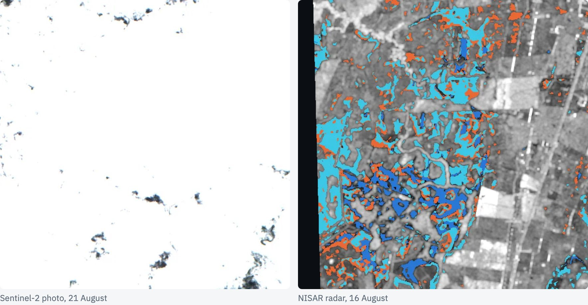

*Figure 1. The same fields of northern Rocha: Sentinel-2 photo on 21 August (left, mostly cloud) and the NISAR radar on 16 August (right). Orange: water detected after the storm; blue: water before the storm (baseline); cyan: water detected before the storm, from earlier rains (not counted).*


## 2. Data

- **Product.** NISAR **Level-2 GCOV** (Geocoded Covariance): terrain-corrected backscatter (gamma-naught, radiometric terrain correction) on a 20 m grid, delivered as HDF5. We read the diagonal terms `HHHH` and `HVHV` from `/science/LSAR/GCOV/grids/frequencyA/`.
- **Access.** Scenes are found with `asf_search` (ASF DAAC) and only the area of interest is cut from each 1–2 GB scene with GDAL over HTTP (`/vsicurl/`), using Earthdata Login credentials. Each crop keeps the frame's native projection (UTM), with an identical grid for every date of a track.
- **Time window.** 15 June to 20 October 2026, **PROVISIONAL** products only. VALIDATED products start on 21 October and show a calibration jump of about −1.7 dB in HH over land; mixing them without normalization would look like new water (team rule 3).
- **One series per orbit.** Each track (orbit number, ascending/descending, frame) always looks from the same angle, so a pixel can be compared with itself pass after pass. Time series are built one track at a time; tracks are combined only as water masks (team rule 2).
- **Quality filters.** Passes that cover less than 80% of the track's usual footprint (partial frames) are dropped, as are passes whose scene-wide median deviates more than 5 dB from the track's median (broken calibration). Values below −50 dB are treated as no data.
- **Global data gap.** NISAR has no passes anywhere between 27 July and 10 August, so the pre-storm reference comes from June and July.
- **Northern Rocha.** 19 passes from two orbits (53D-105 and 31A-161), 12-day revisit per orbit. A third orbit (132A-161) is processed for diagnosis but left out of the results (see section 7).

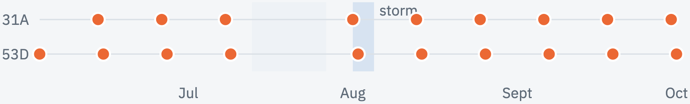

*Figure 2. NISAR passes over northern Rocha for each orbit used, with the storm (shaded) and the global data gap (27 July to 10 August).*


## 3. Why HH for detection, and where HV is used

NISAR acquires dual polarization over Uruguay: **HH** (horizontal transmit, horizontal receive) and **HV** (horizontal transmit, vertical receive). There is no VV.

The flood detector uses **HH only**, for three reasons:

1. **Strongest water/land contrast.** Calm water is a specular reflector in co-polarization: in HH it drops to about −20 to −23 dB while dry pasture sits around −8 to −10 dB, a contrast of more than 10 dB. In cross-polarization (HV), both water and smooth bare soil are very weak and close to the instrument noise floor, so the contrast is smaller and noisier.
2. **Sensitivity to flooded vegetation.** HH is the channel that rises with the water-trunk double bounce, which is the signature of water under vegetation at L-band.
3. **Complete time series.** Some scenes in the archive are HH-only (single polarization). Using HH keeps every pass in the series.

HV is still used where it adds information: in the **flooded-vegetation analysis** (the HH−HV ratio rises when double bounce dominates over volume scattering, section 9) and to recognise vegetated pixels (HV above −20 dB) when screening candidates for water under vegetation.

## 4. Cleaning the image (speckle)

Each radar pixel is the coherent sum of many small echoes, which produces a salt-and-pepper grain called **speckle**. We apply a **5×5 moving average** (about 100 m) **in linear power, not in decibels**, because speckle is multiplicative and averaging in dB would bias the result low. Missing pixels are ignored in the average so the crop edges are not eroded. Values are then converted to dB.

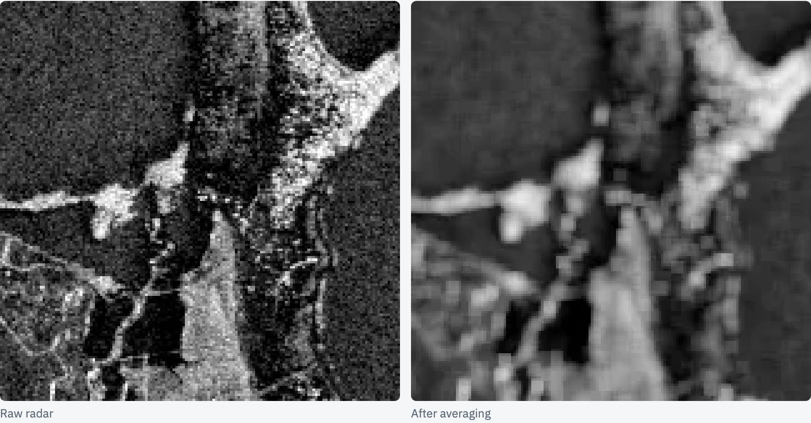

*Figure 3. The same 3.2 km patch before (left) and after (right) the 5×5 average in linear power.*


## 5. What is normal for each place

- **Baseline ("normal").** For every pixel, the **median HH of the passes before the storm** (before 27 July; four passes on orbit 53D in northern Rocha). The median is robust to a single unusual pass, for example one taken after a July rain.
- **Permanent water.** Lakes, lagoons and rivers that are always dark are marked as permanent water and kept out of the flood detection. A pixel is permanent water if it is darker than the **track's calibrated threshold** on most of the baseline passes. The threshold is placed 30% of the way from the median of permanent water (pixels below −20 dB on all baseline passes) to the median of land (pixels above −14 dB), and clipped to −20…−17.5 dB (default −18 dB). In northern Rocha (orbit 53D) it is −18.1 dB.

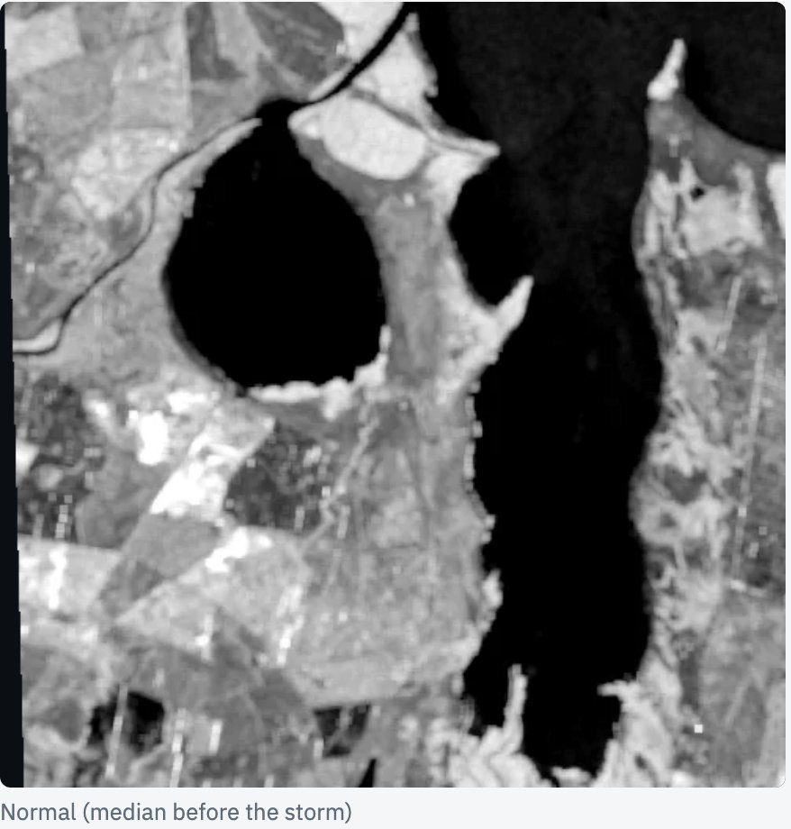

*Figure 4. Each pixel's normal: median HH of the four passes before the storm (northern Rocha, orbit 53D). Dark areas are permanent water.*

- **Wind.** Wind ripples open water (Bragg scattering) and makes it bright, like land. In the Laguna Merín area (orbit 53D), all four baseline passes together give only 5,078 ha of permanent water, because the windy pass breaks the majority; using only the three **calm passes** (ERA5 10 m wind below 3 m/s at the time of the pass) gives 13,356 ha and the lagoon shows up as solid water. Wind comes from ERA5 / ERA5-Land through the Open-Meteo archive, read at a point over **inland water**, never over the ocean, where wind is stronger.
- **Ocean.** The northern Rocha crop includes about 35,000 ha of Atlantic Ocean. Only part of it qualified as permanent water, and on calm days the rest turned dark and looked like new water. The ocean is masked as **no data**: the ESA WorldCover water body that touches a hand-drawn polygon on the sea side, limited to that polygon plus 1.5 km and dilated 2 pixels to remove mixed surf pixels. Inland lagoons are not affected.

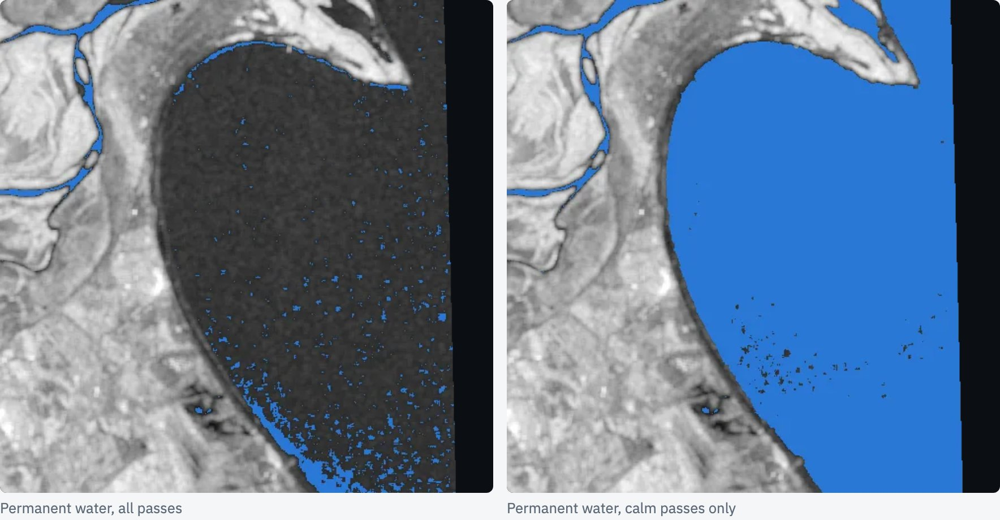

*Figure 5. Permanent water (blue) in the Laguna Merín area with all baseline passes (left) and with calm passes only (right).*


## 6. Finding new water

On each pass, for each pixel:

1. **Change against its own normal:** `ΔHH = HH(pass) − HH(normal)`.
2. **Scene normalization:** the median ΔHH over land (outside permanent water) is subtracted, which removes shifts of the whole pass (calibration drift, generally wetter or drier soil).
3. **New water** if the normalized change is below **−3 dB** (much darker than usual) **and** HH is below **−14 dB** (dark enough to be water), outside permanent water and the ocean.
4. **Minimum patch:** connected patches smaller than **10 pixels (0.4 ha)** are removed as residual speckle.

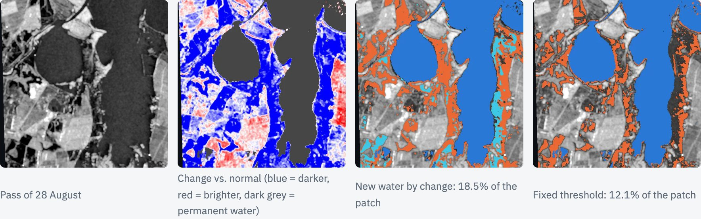

*Figure 6. Peak pass of 28 August in northern Rocha: radar image; change against the normal (blue = darker, red = brighter, dark grey = permanent water); new water by change (18.5% of the patch); the old fixed threshold (12.1%). Orange: water detected after the storm; blue: water before the storm (baseline); cyan: water detected before the storm, from earlier rains (not counted).*


The −14 dB ceiling prevents a field that simply became smoother (ploughed, grazed) from being flagged: it can drop 3 dB but stays brighter than water.

**Why change detection instead of a fixed darkness threshold.** The HH histogram of these scenes is not bimodal, so automatic global thresholds (Otsu) fail, and a fixed threshold misses shallow water that only reaches −14 to −17 dB. Comparing each pixel with itself cancels the differences in viewing angle, terrain and land cover between places and between orbits. On the peak pass in northern Rocha (28 August), change detection flags 18.5% of the example window against 12.1% with the old fixed threshold of −18.1 dB, and the extra area is shallow water that Sentinel-1 also sees darkening.

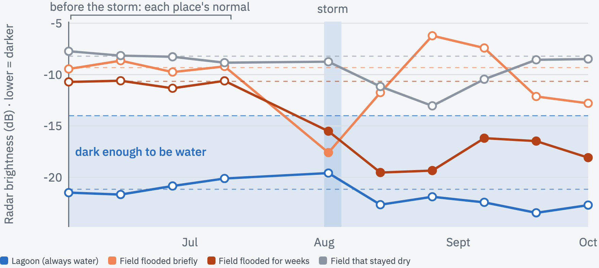

*Figure 7. How dark four real places looked to the radar on every pass. The first points define each place's normal (dashed lines); the shaded band below −14 dB is dark enough to be water; filled dots are passes flagged as new water. A lagoon stays in the water zone; a field flooded briefly dips once; a field flooded for weeks stays down; a dry field never qualifies.*


**Water before the rain.** NISAR data resumed on 10 August, before the storm. Land already wet on passes taken **before the rain started** (from the July and early-August rains) cannot be attributed to the storm or dated. It is kept apart as "water detected before the storm" (shown in cyan) and excluded from the flooded area, the durations and the roads. A pass counts as pre-rain **by the time it was taken**: the 31A pass of 15 August at 09:29 UTC came about 20 hours before the rain started, so it is pre-rain even though it falls on the first day of the event (cut-off 16 August 00:00 UTC).

## 7. Combining orbits

- **Common grid.** The new-water masks of each orbit are reprojected (nearest neighbour) to the grid of the orbit with the most passes. Only masks are combined, never backscatter values, because each orbit has its own geometry and calibration.
- **No data is not dry.** In the per-date masks, permanent water and missing pixels are stored as "no data" (255), so an orbit that cannot see new water at a place (for example because that place is permanent water for that orbit) does not vote "dry" against another orbit that does see it.
- **Confirmed flood.** A pixel counts as flooded by the storm if it was seen as new water on **at least two observations** (any orbit) between 15 August and 10 September, excluding the pre-rain water.
- **Excluded orbit.** In northern Rocha, orbit 132A-161 is left out of the combination and the maps. Its permanent water came from a single calm baseline pass, it recognized only 57% of the known permanent water (versus 96–97% for the other two orbits, see section 10), and on its last pass before the storm it marked as already flooded about 1,700 ha that orbit 31A saw dry the day before the rain. Mixing it in would have hidden part of the storm flooding. It is still processed as a diagnostic.

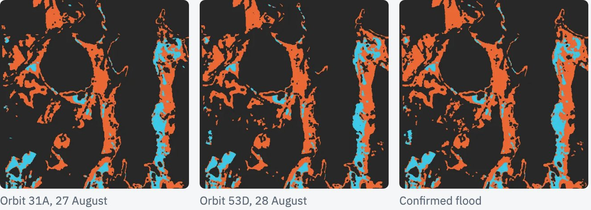

*Figure 8. New-water masks of the two orbits used, on the passes closest to the peak, and the confirmed flood (at least two observations). Orange: water detected after the storm; blue: water before the storm (baseline); cyan: water detected before the storm, from earlier rains (not counted).*


## 8. How long the water stayed

- **Durations are intervals.** With a pass every few days, we only know the last pass a pixel was wet and the first pass it was dry again. Time under water is stored as an interval: the minimum (last wet pass minus first wet pass) and the maximum (first dry pass minus the pass before water first appeared, never earlier than 15 August), plus its midpoint.
- **Retreat** requires **two dry observations in a row** in the combined series, so a single pass from a different geometry that misses the water does not end the flood. Pixels still wet at the last pass use a lower bound (last pass minus first detection).
- **Cropland from October.** In October, ploughing and rice-field preparation look as dark as water, so cropland (ESA WorldCover class 40) is treated as no data from 1 October onwards.
- **Results (northern Rocha).** Among fields that dried before the last pass, the typical duration was **18 days** (median interval 12–24 days); 22% of the flooded land was still wet at the last pass (15 October). The share of the storm footprint still wet fell from 80% on 28 August to 49.6% on 9 September and 30% on 21 September. Because 9 September sits just under the 50% cut, the half-dry date could move one pass (12 days) with slightly different detector settings.
- **Heat map: where the water stayed longest.** Pixel durations are aggregated into **400 m squares**: the value of a square is the mean duration of its flooded pixels; its weight in the heat map is that value times the flooded share of the square (roughly hectare-days per hectare). Squares less than 5% flooded are dropped. This is the map shown in the Story and the explorer.

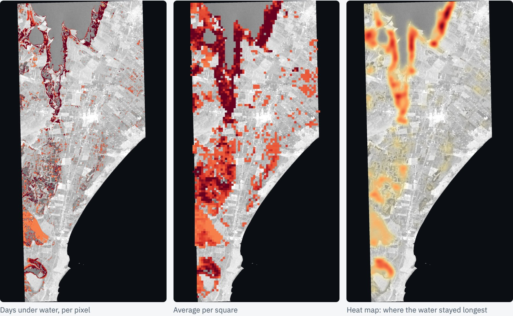

*Figure 9. From pixels to the heat map: days under water per pixel (left), average per 400 m square (middle) and the heat map of where the water stayed longest (right). Colors go from fewer to more days (squares from 6 to 60 days); in the heat map darker also means more of the area flooded.*


## 9. Water under the trees

Under a forest canopy, water does not look dark. The L-band pulse bounces between the water surface and the trunks and returns stronger, so HH rises relative to HV.

- **Riverside vs upland forest.** Height above the nearest drainage (HAND) is computed from the Copernicus DEM (30 m) and OpenStreetMap waterways. **Riverside forest** = forest with HAND below 4 m and within 1 km of a channel; **upland forest** = HAND above 12 m. Comparing both on the same pass removes changes that affect all forest (general moisture, phenology).
- **Signal.** The HH−HV ratio relative to its baseline. A riverside pixel is flagged as water under vegetation if, on some storm pass, its HH−HV rises more than 2 dB above the rise of the upland forest median that day and its HH rises more than 1 dB.
- **Caveat.** In northern Rocha the same signal also appears in herbaceous wetlands with tall grass; the two are not yet well separated.

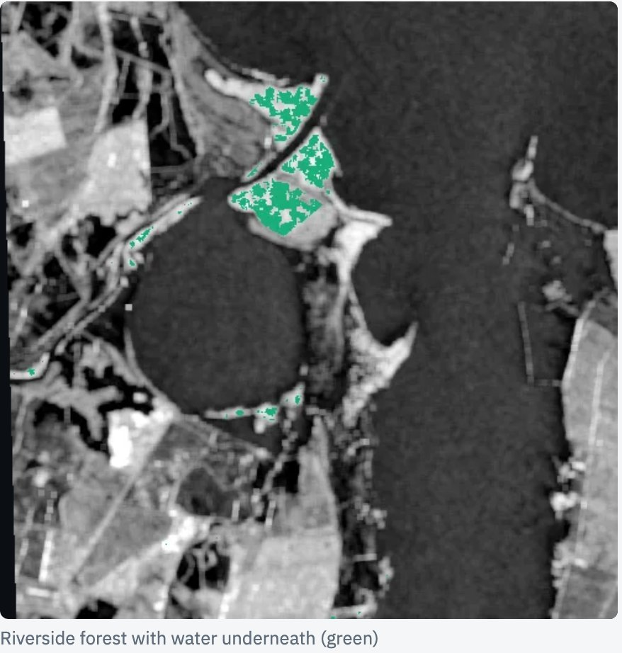

*Figure 10. Riverside forest with water underneath (green) over the radar image, northern Rocha.*

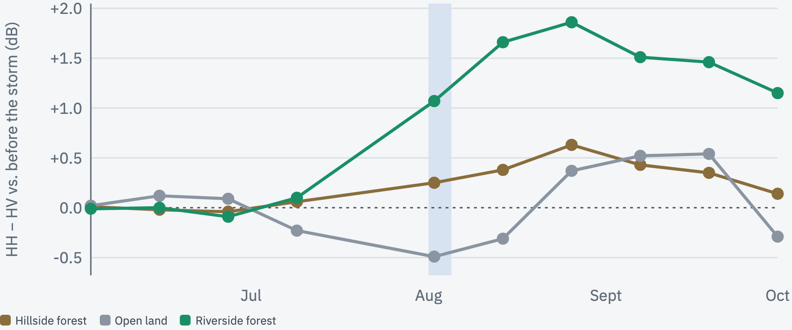

*Figure 11. Change in the HH−HV ratio against the baseline for riverside forest, upland forest and open land, pass by pass. The riverside forest rises close to +2 dB after the storm; the upland forest about +0.6 dB.*


## 10. Checking the results

None of these sources enters the detection (team rule 1).

- **Sentinel-1 (C-band).** Sentinel-1 RTC scenes from Microsoft Planetary Computer, within ±2 days of a NISAR pass, processed with the same change logic: VV change below −3 dB against a baseline from the same relative orbit, and VV below −15 dB (strict) or −12 dB (loose). In northern Rocha (4 comparisons): recall **0.79** (NISAR finds 79% of Sentinel-1's new water), precision 0.52, F1 **0.63** (0.68 with the loose rule). NISAR maps more water than Sentinel-1, consistent with L-band seeing shallow water under grass.

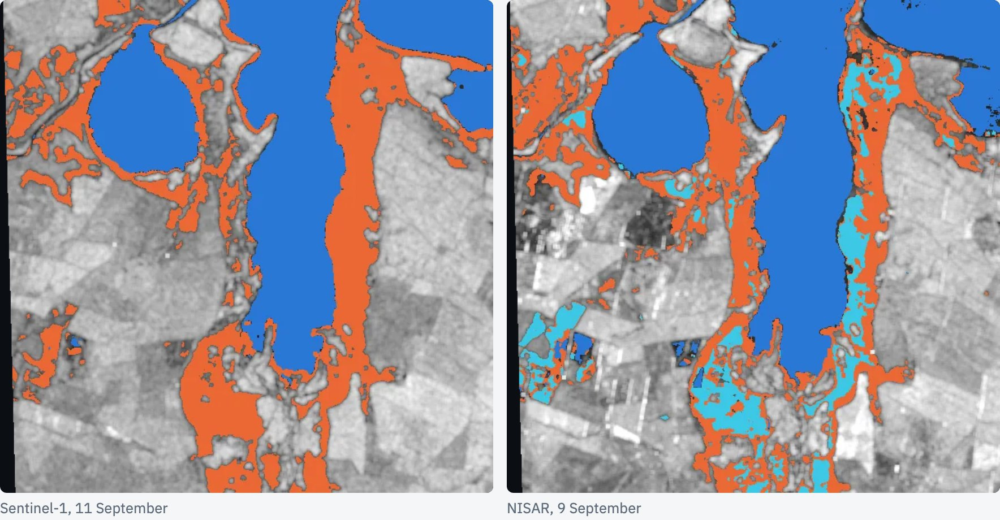

*Figure 12. Sentinel-1 on 11 September (left) and NISAR on 9 September (right) over the same window. Orange: water detected after the storm; blue: permanent water; cyan (NISAR): water detected before the storm.*

- **Agreement between orbits.** Index of overlap (Jaccard) between two NISAR orbits at most one day apart, using only pairs where both passes are after the rain started: **0.72** over 5 pairs.
- **Known water (JRC Global Surface Water).** Share of the water that JRC records as present at least 75% of the time (1984–2021) that NISAR marks as permanent water, without the ocean: 96% (orbit 53D) and 97% (31A), 98–99% more than 60 m from the shore; 57% for the excluded orbit 132A.
- **Noise floor.** The detector is run on each baseline pass against the median of the other baseline passes (leave-one-out), where no real flood is expected. In northern Rocha it flags 155 ha by mistake; the flooded area is **60 times** that. An area is marked "not conclusive" if its flooded area is less than twice its noise floor.
- **Sensitivity.** The detector is rerun with the drop threshold in {−2, −2.5, −3, −3.5, −4} dB and the ceiling in {−13, −14, −15} dB. On orbit 53D alone the flooded extent ranges from 9,020 to 16,881 ha: the headline figure depends on these settings and is a first estimate.
- **Press.** Preliminary reports for northern Rocha around 19 August: 5,000–6,000 ha of waterlogged fields and about 15,000 cattle moved (APU, La R, InfoUruguay, Agrolatam). NISAR measures more, consistent with a wider area and shallow water that is hard to notice from the ground.

## 11. Results for the four areas

| Area | Flooded (≥ 2 obs.) | Already wet before the storm | Half dry | Typical duration | Roads in flooded land |
|---|---|---|---|---|---|
| Northern Rocha (case study) | 9,373 ha | 4,936 ha | 28 Aug – 9 Sep | 18 days (12–24) | 4.8 km |
| Laguna Merín rice fields | 47,449 ha | 27,591 ha | day 25 | 12 days (6–18) | 41.9 km |
| Treinta y Tres | 6,303 ha | 3,093 ha | day 20 | 10 days (1–19) | 13.3 km |
| Río Branco / Jaguarão | 2,070 ha | 440 ha | day 25 | 18 days (12–24) | 3.0 km |

Only northern Rocha has been validated against Sentinel-1 and known water; the other areas are preliminary. In Treinta y Tres the Olimar river itself is not detected as water: in the radar image it looks bright because of the vegetation along its banks.

Roads: OpenStreetMap rural roads are sampled every 20 m and crossed with the flood map; each segment gets the days its land stayed flooded. A 20 m pixel mixes the road and its verge and many rural roads run on embankments, so a road in flooded land is **not necessarily a cut road**.

## 12. Limitations

- **Revisit.** 12 days per orbit (a few days when orbits are combined): durations are ranges, not hours.
- **Wind.** On the main orbit, 2 of the 3 storm passes had wind above 3 m/s, which brightens open water. Those passes are flagged, not corrected.
- **Lowest fields.** Land already wet before the storm (4,936 ha in northern Rocha) is left out entirely. These are often the lowest fields, which also dry last, so drying may look faster than it was.
- **Towns.** Buildings produce strong double bounce; inside towns the radar sees almost no water.
- **Latency.** Data arrives days after each pass: the product serves response, recovery and planning, not early warning.
- **Drying not independently validated.** The Sentinel-1 check compares single passes; the drying curve itself has no independent reference yet.

## 13. Next steps

- **Normalize the signal between orbits**, so that all orbits can feed one more complete timeline instead of using one orbit per series and combining only at the mask level.
- **Improve the water detection with machine learning**, for example a model trained on hand-labelled examples that also uses HV and the shape of each pixel's time series, while Sentinel-1 and JRC remain for validation only.
- **Wind control inside each pass** (how permanent water behaves on that pass) instead of a single ERA5 point.
- **Separate flooded forest from flooded tall-grass wetland.**

## 14. Reproducibility

Everything runs on free data and open-source tools (Python 3.11, GDAL ≥ 3.13). From the repository root (see `README.md` §3–4 for setup):

```bash
python scripts/descargar_zonas.py descargar --zona todas --workers 4   # NISAR GCOV crops (ASF, Earthdata Login)
python scripts/capas_contexto.py        # OpenStreetMap, HydroBASINS, ESA WorldCover
python scripts/clima.py                 # ERA5 wind and rain at pass time (Open-Meteo)
python scripts/metricas_evento.py       # per orbit: permanent water, new water, pre-rain water, durations
python scripts/combinar_tracks.py       # combined orbits: confirmed flood, retreat
python scripts/metricas_evento.py       # second run: removes the combined pre-rain water
python scripts/combinar_tracks.py
python scripts/armonizar_tracks.py      # agreement between orbits
python scripts/sensibilidad.py          # detector settings sweep
python scripts/monte_ribereno.py        # DEM, HAND, water under forest
python scripts/agregar_impacto.py       # roads and land cover
python scripts/validar_s1.py            # Sentinel-1 comparison (validation only)
python scripts/agua_conocida.py         # JRC known-water check (validation only)
python scripts/exportar_optico.py --zona rocha_norte
python scripts/exportar_app.py          # app/data/
python scripts/exportar_metodo.py       # How we did it panels (always after exportar_app.py)
```

The web app is static (`python3 -m http.server -d app 8000`) and is published from `app/` with GitHub Pages.

## Data sources

NASA-ISRO NISAR L2 GCOV (ASF DAAC) · Copernicus Sentinel-1 RTC and Sentinel-2 L2A (Microsoft Planetary Computer) · ERA5 / ERA5-Land (Open-Meteo) · JRC Global Surface Water · ESA WorldCover 2021 · Copernicus DEM GLO-30 · OpenStreetMap (Geofabrik) · HydroBASINS. Press reports are preliminary context (see `docs/event_context_aug2026.md` and `SOURCES.md`).
