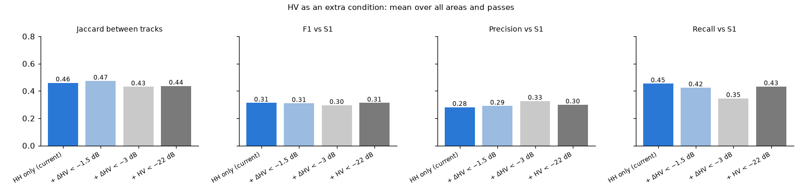
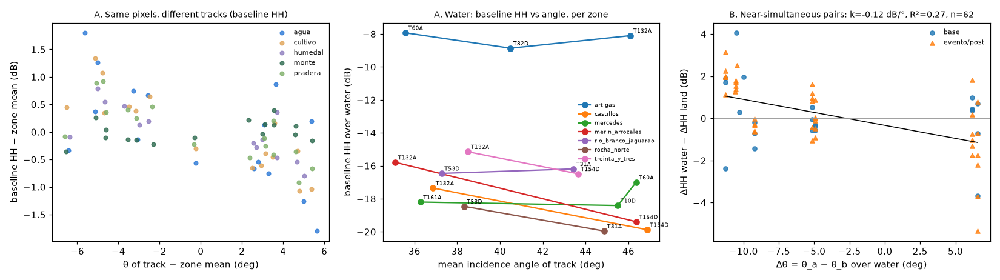
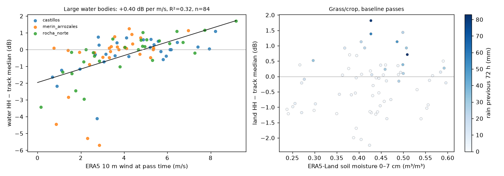

# Resumen de resultados — 15/11/2026: tracks, viento y agua permanente

Branch `feat/eventos-litoral-secado`. Detalle técnico en `docs/guia_metodo.md` §31.9–31.11; cifras vigentes en el README §8 y en `app/data/manifest.json`.

## En una línea

La laguna Merín no figuraba como agua permanente porque **el viento la vuelve brillante en el radar**. Ahora el agua permanente se decide con las **pasadas base de calma** (viento ERA5 < 3 m/s). Mejora mucho el agua permanente y casi no mueve las cifras de inundación: **≈ 68.400 ha en agosto** (antes ≈ 69.000).

## Qué cambió en el método

| Cambio | Por qué | Dónde |
|---|---|---|
| **Agua permanente = oscura en la mayoría de las pasadas base de calma** (viento ERA5 < 3 m/s a la hora de la pasada; si un track no tiene ninguna, todas) | Con viento el agua abierta se riza y sube a −16/−17 dB, por encima del umbral. En Merín 53D dos de cuatro pasadas base tuvieron viento y la laguna no llegaba a la mayoría | `metricas_evento.agua_permanente`, `pasadas_calma`; también en `armonizar_tracks`, `sensibilidad`, `validar_s1` |
| **Etapa nueva `clima.py`**: hora UTC de cada escena (ASF) + viento, lluvia y humedad ERA5 (Open-Meteo, sin clave) | Lo necesita la regla anterior; se guarda en `zonas/{zona}/clima_pasadas.csv` | Pipeline: `capas_contexto` → `clima` → `metricas_evento` → … |
| **Se descartan pasadas con calibración rota** (mediana del recorte a > 5 dB de la del track) | T60A_F162 del 18/6 venía +19/+23 dB y entraba en la base de Salto y Artigas como "la más seca" | `cargar_track` |
| **Regla 1 actualizada**: NISAR es la fuente principal, no la única. Otras fuentes pueden mejorar la detección si la mejora se mide. Sentinel-1 y JRC siguen sólo como validación | Decisión del equipo (15/11) | CLAUDE.md, README §7 |

## Cifras antes / después

**Tormenta de agosto — extensión confirmada (≥ 2 observaciones):**

| Zona | Antes | Después | Piso de ruido antes → después |
|---|---|---|---|
| Merín | 47.918 ha | **47.449 ha** | 1.037 → **349 ha** |
| Rocha norte | 9.869 ha | **9.755 ha** | 254 → 244 ha |
| Treinta y Tres | 6.290 ha | **6.303 ha** | 27 → 27 ha |
| Río Branco | 2.510 ha | **2.510 ha** | 31 → 40 ha |
| Castillos | 1.824 ha | **1.821 ha** | 447 → **34 ha** |
| Durazno (no concluyente) | 341 ha | 341 ha | — |
| Mercedes (no concluyente) | 180 ha | 179 ha | 99 → 107 ha |
| Melo | 35 ha | 35 ha | 7 → 7 ha |
| **Total** | **≈ 69.000 ha** | **≈ 68.400 ha** | |

- Ya mojado antes de la lluvia: 38.700 → **38.550 ha**. Caminos bajo agua: 65 → **64 km** (49 km > 1 semana).
- Banda de sensibilidad Merín 53D: 30–67 mil → **30–66 mil ha**. Persistencia típica sin cambios (Merín ~12 d, TyT ~10 d, Rocha ~16 d, Río Branco y Castillos ~18 d).
- **Octubre (litoral):** Paysandú 803 → **784 ha**, **Artigas 46 → 20 ha** (efecto de quitar la pasada rota), Salto ~0. Las zonas no concluyentes siguen siendo las mismas (Durazno, Mercedes, Salto).
- El **piso de ruido** (falsa alarma del detector en las pasadas base) baja mucho donde había lagunas mal leídas: por track, Merín 53D 1,50 % → 0,10 %, Castillos 132A 0,66 % → 0,01 %, Rocha norte 53D 2,16 % → 0,65 %.

**Agua permanente en la laguna Merín** (% de la laguna marcada como agua base):

| Track (ángulo) | Antes | Después |
|---|---|---|
| T53D (36°) | 11 % | **91 %** |
| T132A (36°) | 3–5 % | **92 %** |
| T154D (46°) | 93 % | 93 % |

## Validación

| Métrica | Antes | Después |
|---|---|---|
| Agua permanente vs JRC Global Surface Water (F1, 27 tracks) | 0,37 | **0,50** |
| Agua permanente: coincidencia entre tracks (Jaccard) | 0,30 | **0,40** |
| Agua nueva: coincidencia entre tracks a ≤ 1 día (Jaccard, pares con agua) | 0,46 | **0,49** |
| Agua nueva vs Sentinel-1 (F1, 76 pasadas) | 0,31 | 0,31 |

Las dos primeras filas salen de `comparar_global.py` (misma regla que quedó en el pipeline); las dos últimas, del pipeline regenerado.

## Qué se investigó y se descartó

1. **HV como condición extra del detector de agua nueva** (`comparar_hv.py`): sube la precisión contra S1 (0,28 → 0,33) pero pierde agua real somera; F1 igual (0,31). Descartado. El cociente HH/HV sólo sirve para el monte inundado.

   

2. **Normalizar los tracks por ángulo de incidencia para usar un umbral global** (`angulo_incidencia.py`, `diagnostico_tracks.py`, `comparar_global.py`). El ángulo sí pesa (pradera/cultivo −0,10…−0,15 dB/°, agua abierta ~−0,3 dB/°, monte ~0; entre tracks de una zona hay hasta 12°), pero normalizar agrega poco: umbral global + ángulo + calma da F1 0,51 contra 0,50 de "umbral por track + calma". Con dos pendientes (agua/tierra) sobrecorrige los tracks de ángulo alto (Merín 154D: 92 % → 37 %). La detección de agua nueva no cambia con ninguna variante, porque compara cada píxel con su propia base en el mismo track.

   

3. **El viento explica lo que el ángulo no** (`clima_pasadas.py`): restando la mediana del propio track, el agua de las lagunas está 1,4 dB más oscura con viento < 2 m/s (hasta 4–6 dB) y estable desde ~3 m/s. El 46 % de las pasadas tienen < 3 m/s, a la mañana y a la tarde por igual.

   

4. **HV sobre el agua es el piso de ruido del sensor**: sube con el ángulo (+0,2 dB/°). No sirve para reconocer agua permanente.

## Puntos abiertos

- **Viento en las pasadas del evento:** un campo inundado con viento también puede verse brillante y no detectarse como agua nueva. No está medido. Propuesta: marcar como "baja confianza" las pasadas del evento con viento alto y medir el efecto contra S1.
- **Quedan ~220 ha de "agua nueva" dentro del contorno de la laguna Merín** (antes ~250), sobre todo en el borde donde la laguna no llega a agua permanente. Revisar si son orilla real inundada o ruido.
- **Validación desactualizada en el README y `docs/validacion.md`:** citan F1 0,44 / 60 % de exhaustividad de una corrida anterior (47 comparaciones). La corrida actual (76 comparaciones, misma metodología de `validar_s1.py`) da F1 0,31 / exhaustividad 0,46 / F1 laxa 0,35 (Rocha norte 0,61 / 0,67). Hay que revisar qué cambió entre ambas y actualizar esos textos.
- **El viento ERA5 es de una celda de ~10–25 km** y de un solo punto por zona (centroide del agua). Para zonas grandes o con varias lagunas puede no representar a todas.

## Para el equipo de UI (`feat/storytelling-ui`)

- `app/data/` se regeneró en esta branch. Al mergear, el `manifest.json` va a tener conflicto: se resuelve corriendo `scripts/exportar_app.py` después del merge.
- La carpeta `data_nisar/` es compartida entre worktrees: los rasters ya tienen las cifras nuevas. Si la UI vuelve a exportar, va a tomar las cifras nuevas.
- Cifras que cambian en la historia: total agosto ≈ 68.400 ha (antes 69.000), Merín 47.449 ha, Artigas 20 ha, caminos 64 km.

## Commits de esta tanda

`c16fac8` piso de ruido y zonas no concluyentes · `05e6300` experimento HV y diagnóstico · `232204d` pasadas rotas + diagnóstico de ángulo · `aadb53f` clima por pasada y comparación global · `24059cd` regla 1 · `33f8c01` agua permanente con pasadas de calma · `82b017e` guía §31.9–31.11 · `81a83d1` salidas regeneradas.
